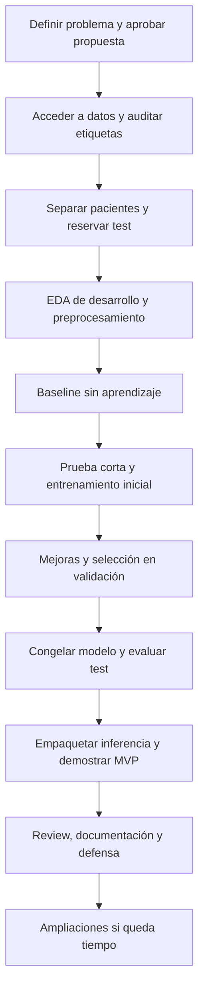

# Plan de trabajo: clasificación de hallazgos en radiografías de tórax

**Estado:** planificación; las casillas representan trabajo pendiente, no resultados obtenidos.

**Base:** `consigna.pdf`, los materiales de `Slides/`, los enlaces de `datasets/` y la plantilla del trabajo final de la materia.

**Fecha de revisión:** 18 de octubre de 2026.

**Modalidad considerada:** grupal, según lo expresado por el equipo. Completar integrantes, responsabilidades y fecha de entrega al aprobar la propuesta.

## 1. Qué vamos a construir

Un prototipo que reciba una radiografía frontal de tórax, aplique un modelo entrenado por el equipo y devuelva los **hallazgos compatibles con las etiquetas que aprendió**, junto con un score por hallazgo y los umbrales utilizados.

La tarea es **clasificación supervisada multietiqueta**: una imagen puede tener varios hallazgos simultáneos. Por ejemplo, cardiomegalia y derrame pleural pueden coexistir. No corresponde obligar al modelo a elegir una sola clase mediante `softmax` si los datos admiten varias etiquetas.

El objetivo académico es evaluar predicciones sobre las etiquetas disponibles. No se debe presentar la salida como un diagnóstico clínico confirmado: las etiquetas de entrenamiento tienen limitaciones y el sistema no dispone de toda la información de un paciente.

### Ruta propuesta para empezar

| Decisión | Propuesta inicial | Cuándo revisarla |
|---|---|---|
| Dataset principal | CheXpert; usar imágenes frontales y una versión de resolución reducida si está disponible en el acceso oficial | Antes de descargar imágenes |
| Salidas del MVP | Atelectasis, Cardiomegaly, Consolidation, Edema y Pleural Effusion | Después de revisar disponibilidad y distribución de etiquetas |
| Modelo inicial | ResNet-18 con pesos de ImageNet y una cabeza nueva de cinco salidas | Después de una prueba corta de entrenamiento |
| Entrenamiento | Primero cabeza; luego ajuste fino de un bloque del backbone | Si la validación y el presupuesto de cómputo lo justifican |
| Entrega mínima | Pipeline reproducible, evaluación reservada y predicción desde consola | Desde el inicio |
| Presentación | Página estática con resultados y demostración del prototipo; interfaz interactiva opcional | Cuando el modelo ya funcione |
| Segundo dataset | NIH ChestX-ray14 como evaluación adicional opcional, con etiquetas armonizadas | Después de cerrar el MVP |

Estas son **decisiones propuestas**, no imposiciones de la consigna ni hechos ya implementados. Si CheXpert no resulta accesible, se puede desarrollar el MVP sobre NIH siguiendo los ajustes de la sección 5.

## 2. Qué exige la consigna y cómo lo vamos a demostrar

La referencia principal de este plan es [consigna.pdf](consigna.pdf). El README del material de la materia aporta la plantilla y sugerencias de presentación, pero contiene una rúbrica distinta. Tomar la del PDF como referencia de trabajo y confirmar con el docente cualquier diferencia antes de la revisión.

| Requisito | Referencia del PDF | Evidencia que prepararemos |
|---|---|---|
| Propuesta formal antes de codificar | §2.2, pp. 3–4 | README con problema, datos, baseline, métricas y alcance |
| Separación de responsabilidades | §2.1, p. 3 | `data/`, `notebooks/`, `src/`, `models/` |
| Uso de ramas e incrementos lógicos | §2.1 y §5 | Issues, ramas, commits y revisiones |
| Entorno aislado, Python ≥3.10 y versiones exactas | §2.3, pp. 4–5 | Manifiesto de dependencias y entorno reproducible |
| Semillas en las operaciones aleatorias | §2.3, p. 5 | Configuración y registro de ejecución |
| MVP de IA funcional antes de módulos accesorios | §2.2 y §3.1 | Predicción con un modelo realmente entrenado |
| Review con la cátedra y defensa | §3.1, pp. 5–6 | Demo, resultados, preguntas y correcciones |
| Código modular y README exhaustivo | §5, pp. 10–11 | Ejecución desde un clon limpio siguiendo instrucciones |
| Modelo, limpieza y prevención de fugas | Rúbrica, p. 12: 45 % | EDA, protocolo de partición y experimentos |
| Validación y métricas | Rúbrica, p. 12: 20 % | Resultados de test, soporte por clase y análisis estadístico |
| Arquitectura y código | Rúbrica, p. 12: 15 % | Módulos desacoplados y pruebas relevantes |
| Visibilidad | Rúbrica, p. 12: 10 % | Página y demostración con resultados reales |
| Git y MLOps | Rúbrica, p. 12: 10 % | Trazabilidad entre código, datos, configuración y modelo |

**Prioridad de esfuerzo:** modelo y validación suman el 65 %. Primero datos y evaluación, después interfaz.

En modalidad grupal, el PDF establece MVP, review y defensa; el máximo académico es promoción con coloquio, condicionado también por las actividades opcionales. Los dos ejes adicionales de escalado corresponden al camino individual de Proyecto Funcional: no son una obligación extra del MVP grupal. Aun así, planificamos una página de resultados porque aparece en los materiales de presentación y en la rúbrica. La publicación es explícitamente obligatoria para Proyecto Funcional.

## 3. Orden general y dependencias



Cada etapa termina con un entregable y una condición de cierre. No avanzar a entrenamientos largos sin validar antes datos, particiones y una ejecución pequeña.

## 4. Etapa 0 — Acordar el problema y la propuesta

### Tareas

- [ ] Completar nombres del equipo, responsables, disponibilidad semanal y fecha real de entrega.
- [ ] Crear un tablero con columnas Pendiente, En curso, En revisión y Terminado.
- [ ] Confirmar con el docente la modalidad, el enfoque multietiqueta y el uso de transferencia de aprendizaje.
- [ ] Redactar la propuesta formal usando la [plantilla de README](git-profe/trabajo_final/plantilla/README.md).
- [ ] Definir entrada: una radiografía frontal de tórax en los formatos acordados, inicialmente JPEG/PNG.
- [ ] Definir salida: una lista de scores y decisiones por etiqueta; no una patología única obligatoria.
- [ ] Aprobar el conjunto inicial de cinco etiquetas o documentar otra selección basada en los datos.
- [ ] Definir qué computadora o entorno ejecutará los entrenamientos y quién podrá acceder a los artefactos.

### Pregunta que debe responder el proyecto

> ¿Un modelo ajustado con radiografías etiquetadas identifica los cinco hallazgos seleccionados mejor que un baseline simple, cuando se evalúa en pacientes que no aparecieron durante el entrenamiento?

### Fuera del MVP

Login, historias clínicas, base de datos de pacientes, generación de informes médicos, integración hospitalaria, imágenes DICOM, segmentación de lesiones y entrenamiento de un modelo fundacional desde cero. Son ampliaciones posibles, no tareas iniciales.

### Objetivos medibles propuestos

- Comparar todos los modelos sobre las mismas particiones y etiquetas observadas.
- Usar **macro Average Precision (macro-AP)** como métrica principal y AUROC por etiqueta como complemento.
- Propuesta para acordar con el docente: mejorar la macro-AP del baseline de prevalencia en al menos 0,05 puntos absolutos y buscar macro-AUROC ≥0,75 en la validación de desarrollo. Son metas de proyecto, no resultados ni garantías.
- Reportar precision, recall y F1 con umbrales fijados en validación; no aceptar un buen promedio que oculte una clase fallida.
- Medir tiempo de inferencia por imagen, equipo utilizado y condiciones de la medición.
- Si una meta no se alcanza, documentar la evidencia, las causas investigadas y las limitaciones. No modificar el test para mejorar el resultado.

**Entregable:** propuesta en README y primer hito del tablero.

**Cierre:** el equipo puede explicar qué va a predecir, con qué datos y cómo sabrá si mejora.

## 5. Etapa 1 — Elegir y obtener los datos

### Qué hay actualmente en este repositorio

| Archivo | Contenido |
|---|---|
| [datasets/dataset1/link](datasets/dataset1/link) | Enlace al repositorio NIH ChestX-ray |
| [datasets/dataset2/link](datasets/dataset2/link) | Enlace a CheXpert de Stanford |
| [readme.md](readme.md) | Actualmente contiene «Hola mundo» |

Los enlaces son referencias: **no equivalen a tener los datasets descargados ni auditados**.

### Comparación de las dos fuentes

| Aspecto | NIH ChestX-ray14 | CheXpert |
|---|---|---|
| Tamaño de referencia | 112.120 radiografías en la versión ampliada del trabajo original | 224.316 radiografías de 65.240 pacientes en la publicación original |
| Tipo de tarea | Varias etiquetas de hallazgos por imagen | Varias observaciones por imagen, con incertidumbre explícita |
| Etiquetas | 14 hallazgos; el artículo distingue la versión original ChestX-ray8 de la ampliación a 14 | 14 observaciones; no todas son patologías, por ejemplo Support Devices |
| Vistas | Frontales en el dataset descrito | Incluye vistas frontales y laterales; filtrar las frontales para este MVP |
| Punto a revisar | Etiquetas extraídas de informes y su ruido | Positivos, negativos, inciertos y no mencionados |
| Uso propuesto | Alternativa principal o evaluación adicional | Principal para la primera versión |

Fuentes: [Wang et al., apéndice B de ChestX-ray14](https://arxiv.org/pdf/1705.02315) y [presentación oficial de CheXpert](https://stanfordmlgroup.github.io/competitions/chexpert/). Los tamaños anteriores describen publicaciones: contar los archivos de la versión realmente descargada.

### Tareas de acceso

- [ ] Abrir los enlaces oficiales y completar los pasos de acceso y condiciones de uso que correspondan.
- [ ] Leer README, licencia, diccionario de etiquetas y descripción de particiones del dataset elegido.
- [ ] Registrar fuente, versión, fecha de acceso, archivos descargados y tamaño en disco.
- [ ] Descargar primero los metadatos disponibles y una parte pequeña de imágenes para verificar el pipeline.
- [ ] Verificar que las imágenes de esa parte puedan relacionarse con las filas del CSV. Si falta parte de la descarga, marcarla como muestra parcial, no como imagen corrupta.
- [ ] Determinar espacio disponible y presupuesto de descarga antes de traer el conjunto completo.
- [ ] Conservar los originales en `data/raw/`; generar derivados en `data/processed/`.
- [ ] Mantener imágenes y metadatos de pacientes fuera de Git; versionar instrucciones, esquemas y resúmenes agregados.

### Si elegimos NIH como principal

Mantener el diseño multietiqueta y construir vectores binarios a partir de sus etiquetas. Verificar en su diccionario los nombres `Atelectasis`, `Cardiomegaly`, `Consolidation`, `Edema` y `Effusion`, si se conserva la selección propuesta. Usar sus particiones publicadas cuando correspondan y comprobar siempre separación por paciente. La política de incertidumbre de CheXpert no se traslada automáticamente a NIH.

### Si después usamos ambos

El segundo dataset es opcional: la consigna no exige entrenar con dos. Primero cerrar una evaluación interna válida. Para evaluar generalización entre fuentes, armonizar definiciones y vistas, conservar la fuente y declarar diferencias de etiquetado. `Effusion` y `Pleural Effusion` requieren revisar su equivalencia; no concatenar columnas solo por parecido del nombre. Si se ajusta el modelo o se eligen umbrales mirando NIH, esa parte de NIH pasa a ser desarrollo, no test externo.

**Entregable:** ficha del dataset en `reports/dataset.md`, con acceso, versión, variables, licencia y limitaciones.

**Cierre:** podemos abrir imágenes y vincularlas con sus etiquetas y pacientes.

## 6. Etapa 2 — Preparar repositorio y entorno

El proyecto debe vivir en su propio repositorio, no dentro de una carpeta del repositorio de la materia. Si `iaproyecto` es ese repositorio propio, colocar aquí la implementación. `git-profe/` y `Slides/` pueden conservarse como material de referencia, sin desarrollar el modelo dentro de ellos.

### Estructura de destino

Se conserva la separación de la plantilla y se agregan carpetas pequeñas para configuración, particiones y resultados:

```text
iaproyecto/
├── README.md                     # README final basado en la plantilla
├── PLAN_PROYECTO_RX_TORAX.md       # este plan
├── pyproject.toml                 # dependencias directas con versiones exactas
├── requirements.lock.txt          # o lock equivalente del gestor elegido
├── .gitignore
├── configs/                       # etiquetas, transforms e hiperparámetros
├── splits/                        # protocolo y resúmenes; manifiestos si se permite
├── data/                          # excluido de Git
│   ├── raw/
│   └── processed/
├── notebooks/                     # exploración y visualización
├── src/
│   └── torax/                     # paquete Python instalable
│       ├── __init__.py
│       ├── data.py                # lectura de metadatos e imágenes
│       ├── labels.py              # codificación y máscaras de etiquetas
│       ├── split.py
│       ├── transforms.py
│       ├── baseline.py
│       ├── model.py
│       ├── train.py
│       ├── evaluate.py
│       └── predict.py
├── models/                        # pesos y metadatos del modelo
├── reports/                       # resultados y análisis versionables
├── tests/                         # controles de integridad y del pipeline
└── docs/                          # presentación estática
    ├── index.html
    ├── img/
    └── assets/
```

Es una estructura a construir; esos módulos todavía no existen. Adaptar el descubrimiento de paquetes de `pyproject.toml` al layout `src/` y comprobar que `torax` se importe después de instalarlo.

### Tareas

- [ ] Elegir Python ≥3.10 compatible con las dependencias del equipo. En este PC se encontró Python 3.12.3.
- [ ] Elegir un solo gestor: `venv` y `pip`, o `uv` si se sigue el flujo de la materia.
- [ ] Adaptar el manifiesto de la plantilla. Sus dependencias de ejemplo usan rangos: la consigna pide fijar versiones exactas para la entrega.
- [ ] Incorporar únicamente las dependencias necesarias: PyTorch/Torchvision, pandas, NumPy, Pillow, scikit-learn, Matplotlib y herramientas de notebooks/pruebas.
- [ ] Registrar versiones de Python, librerías, hardware y dispositivo CPU/GPU; definir una semilla global.
- [ ] Preparar una configuración común para etiquetas, tamaño de imagen, batch size, learning rate y rutas.
- [ ] Añadir exclusiones de `data/`, cachés, entorno virtual, credenciales, pesos pesados y archivos temporales antes de agregarlos a Git.
- [ ] Resolver el README raíz: existe `readme.md`; acordar su renombre a `README.md` y completar la plantilla sin dejar dos documentos divergentes.
- [ ] Crear ramas por tarea y commits que describan avances verificables.

### Primeros comandos de preparación

Ejecutarlos al abordar esta etapa. Este plan no instala dependencias ni modifica la estructura por sí mismo:

```bash
cd /home/marc/Documentos/GitHub/iaproyecto
git status
git switch -c feat/base-proyecto
python3 -m venv .venv
source .venv/bin/activate
python --version
```

Después de crear y revisar el manifiesto:

```bash
python -m pip install -e .
python -m pip freeze > requirements.lock.txt
```

El lock registra el entorno resuelto; no reemplaza el requisito de fijar las dependencias directas del manifiesto. Documentar diferencias de instalación entre CPU y GPU, si las hay. Las semillas ayudan a reproducir: verificar también las operaciones no deterministas y registrar las limitaciones del hardware/software.

**Entregable:** instalación documentada, configuración inicial y árbol del proyecto.

**Cierre:** otro integrante puede instalar e importar el proyecto en un entorno limpio.

## 7. Etapa 3 — Auditar metadatos y reservar los pacientes de test

### Crear un manifiesto de trabajo

Una fila por imagen con, como mínimo:

```text
image_id, relative_path, patient_id, study_id, source, view,
age, sex, label_atelectasis, label_cardiomegaly,
label_consolidation, label_edema, label_pleural_effusion
```

Conservar solo las variables disponibles; registrar si `study_id`, edad o sexo faltan. Estas variables sirven para partición y análisis de sesgos; el MVP propuesto predice a partir de la imagen, no de identificadores o de nombres de archivo.

### Tareas de integridad previas al entrenamiento

- [ ] Contar imágenes, pacientes, estudios y filas por fuente y vista.
- [ ] Detectar rutas inexistentes, filas duplicadas e imágenes ilegibles.
- [ ] Identificar duplicados exactos por hash y agrupar sus copias en una sola partición.
- [ ] Resolver duplicados con etiquetas incompatibles mediante una regla documentada; no elegir la etiqueta según lo que prediga el modelo.
- [ ] Registrar causas de exclusión y cantidades antes/después.
- [ ] No eliminar automáticamente casos raros o imágenes difíciles por ser outliers: podrían ser la señal que buscamos.

### Separación sin fuga de información

1. Respetar los conjuntos oficiales reservados y sus condiciones de uso.
2. Si se desarrolla con el `train` público de CheXpert, dividir **sus pacientes** en train, validación interna y test interno; propuesta: 70/15/15.
3. Garantizar que todas las imágenes y estudios de un paciente caigan en el mismo conjunto. Un split aleatorio por imagen no sirve.
4. Mantener también los grupos de duplicados en un único conjunto.
5. Guardar asignaciones y semilla. `GroupShuffleSplit` es una herramienta posible, pero no garantiza balance multietiqueta; revisar distribución y documentar el método elegido.
6. Contar positivos y negativos conocidos por clase y conjunto antes de cerrar las particiones. Como guía de viabilidad, buscar al menos 30 de cada uno en validación y test; no es un umbral de validez clínica.
7. Congelar test antes de experimentar con modelos. Si falta soporte para evaluar una clase, resolver la selección antes de medir resultados del modelo.
8. Una vez reservado, usar train para decisiones exploratorias y validación para seleccionar configuraciones. No hacer EDA dirigido a optimizar el modelo mirando los errores de test.

El conjunto `valid` público de CheXpert puede aportar una comprobación complementaria con anotaciones expertas si su versión las incluye. Si se usa para ajustar modelos, no presentarlo después como evaluación independiente. No asumir que el test oficial de la competición está disponible con sus etiquetas.

**Entregable:** protocolo de split, manifiestos locales y resumen por conjunto; verificación automática de intersección de pacientes igual a cero. Publicar listas con identificadores solo cuando las condiciones del dataset lo permitan.

**Cierre:** ningún paciente ni duplicado cruza de train a validación/test.

## 8. Etapa 4 — EDA y preparación de etiquetas e imágenes

### Qué analizar y guardar

- [ ] Distribución de positivos, negativos, inciertos y no mencionados por etiqueta.
- [ ] Coocurrencia de hallazgos y cantidad de etiquetas positivas por imagen.
- [ ] Resolución, formato, canales e histogramas de intensidad.
- [ ] Imágenes de ejemplo por etiqueta y ejemplos de etiquetas coexistentes.
- [ ] Diferencias por AP/PA, sexo y edad cuando esos datos estén disponibles.
- [ ] Desbalance y posibles atajos: textos incrustados, dispositivos, bordes o diferencias de adquisición.
- [ ] Impacto de las exclusiones y de la política de etiquetas sobre la muestra final.

Guardar gráficos en `reports/figures/` y un resumen interpretado en `reports/eda.md`; los notebooks deben reutilizar funciones de `src/`.

### Política inicial para incertidumbre en CheXpert

| Valor original | Interpretación | Tratamiento inicial propuesto |
|---|---|---|
| `1` | Positivo | Target 1, máscara 1 |
| `0` | Negativo explícito | Target 0, máscara 1 |
| `-1` | Incierto | Target auxiliar 0, máscara 0 |
| Vacío / NaN | No mencionado | Target auxiliar 0, máscara 0 |

Esta es una política conservadora **propuesta para el MVP**, no la única estrategia ni una equivalencia entre incierto y negativo. Verificarla contra el diccionario real y medir cuántas etiquetas observadas conserva. El target auxiliar cero solo evita NaN numéricos: con máscara cero no participa en pérdida ni métricas. Si no quedan suficientes ejemplos conocidos, revisar el alcance o comparar otra política en validación. El [artículo de CheXpert](https://arxiv.org/abs/1901.07031) estudia varias estrategias de incertidumbre.

Para NIH, documentar por separado cómo se interpreta pertenecer o no a cada etiqueta de sus informes. `No Finding` no equivale a demostrar salud completa. Si el modelo cubre cinco hallazgos, cinco salidas negativas tampoco descartan los demás.

### Pipeline visual inicial

1. Abrir la imagen y verificar que se pueda decodificar.
2. Mantener la información en escala de grises y documentar el formato de entrada.
3. Para usar una red ImageNet de tres canales, replicar el canal gris en tres canales; esto no agrega información de color.
4. Redimensionar manteniendo proporción y completar con padding hasta 224×224 como punto de partida. Revisar visualmente que no se recorte anatomía; 224 es una propuesta de cómputo, no una resolución óptima demostrada.
5. Aplicar conversión a tensor y normalización coherente con los pesos elegidos. Si se calculan estadísticas propias, estimarlas solo con train.
6. Comparar aumentos pequeños y justificables únicamente en train. Primera corrida sin aumentos como control; después probar rotación/traslación suaves.
7. Mantener validación, test e inferencia sin aumentos aleatorios. No usar volteos verticales ni deformaciones arbitrarias; justificar cualquier volteo horizontal por sus efectos sobre lateralidad y marcadores.
8. Guardar el preprocesamiento como parte del modelo y reutilizarlo exactamente en predicción.

La binarización, Otsu y los filtros de los slides sirven para aprender representación y procesamiento. No incorporarlos todos por haberlos visto: en radiografías pueden eliminar información. Cualquier modificación debe justificarse con una comparación de validación.

**Entregable:** EDA, codificación de etiquetas, máscara y transforms verificadas.

**Cierre:** un batch tiene forma `B×3×224×224`, y targets/máscaras `B×5`, con valores finitos y ejemplos visualmente correctos.

## 9. Etapa 5 — Construir el baseline

### Baseline obligatorio de referencia

Crear un predictor sin aprendizaje visual que, para cada hallazgo, devuelva la frecuencia de positivos observados **solo en train**. Esa frecuencia es un score constante para todas las imágenes. Añadir la decisión «siempre negativo» para mostrar por qué la exactitud puede resultar engañosa ante el desbalance.

- [ ] Estimar prevalencias sin contar etiquetas enmascaradas como negativas.
- [ ] Evaluar con el mismo universo de etiquetas conocidas que se usará con la red.
- [ ] Guardar soporte, AP y AUROC cuando estén definidas; documentar el comportamiento de scores constantes.
- [ ] Reportar precision, recall y F1 del predictor siempre negativo con la convención explícita para divisiones por cero.
- [ ] Guardar resultados y configuración en `reports/baseline/`.

Un baseline visual adicional —backbone congelado con cabeza entrenable— permitirá separar la utilidad de la representación del efecto del ajuste fino.

**Entregable:** comparación cuantitativa inicial reproducible.

**Cierre:** sabemos qué resultado obtiene una estrategia trivial y por qué el modelo debe superarlo.

## 10. Etapa 6 — Entrenar la primera red

### Diseño propuesto

ResNet-18 preentrenada en ImageNet, reemplazando la última capa por cinco logits. Entrenar esa cabeza con nuestros datos y evaluar después si conviene descongelar el último bloque. Entrenar/ajustar parámetros propios cumple una tarea diferente de ejecutar un modelo médico terminado sin modificaciones; explicar esa diferencia en la defensa. Referencias: [transfer learning en PyTorch](https://docs.pytorch.org/tutorials/beginner/transfer_learning_tutorial.html) y [ResNet-18](https://docs.pytorch.org/vision/stable/models/generated/torchvision.models.resnet18.html).

Usar una sigmoide por etiqueta al inferir. Para entrenar, usar `BCEWithLogitsLoss(reduction="none")` sobre los logits, con máscara de etiquetas conocidas. No aplicar una sigmoide extra antes de esa pérdida. La máscara debe implementarse explícitamente; no viene resuelta solo por elegir la pérdida.

```text
pérdida = suma(pérdidas_por_etiqueta * máscara) / suma(máscara)
```

Excluir o saltar batches sin etiquetas conocidas para no dividir por cero. Si se usa `pos_weight`, calcularlo por clase a partir de positivos/negativos observados de train; revisar los casos sin positivos. No combinar todas las técnicas de balanceo a la vez sin una comparación.

### Antes del entrenamiento largo

- [ ] Ejecutar carga → batch → forward → pérdida → backward → guardado.
- [ ] Verificar que entrenar sobre un pequeño lote fijo pueda reducir claramente la pérdida; es un control del pipeline, no una métrica final.
- [ ] Medir consumo de memoria y tiempo por batch.
- [ ] Probar CPU con una muestra pequeña para desarrollo y comprobar un entorno con GPU disponible antes de entrenar sobre un volumen grande.
- [ ] Si se usa un entorno remoto, guardar configuración, pesos y resultados fuera de su disco efímero y registrar versiones.

En este PC se observaron dos CPU lógicas y no se encontró `nvidia-smi`. Eso no acredita por sí solo la ausencia de toda GPU, pero obliga a verificar el dispositivo disponible y a medir tiempos antes de planificar entrenamientos largos.

### Primera configuración a probar

| Parámetro | Punto de partida experimental |
|---|---|
| Resolución | 224×224 |
| Semilla | 42, registrada junto a las versiones |
| Optimizador | AdamW |
| Learning rate de la cabeza | `1e-3` |
| Learning rate de ajuste fino | `1e-4` o menor, comparado en validación |
| Batch size | El mayor que permita memoria sin errores; comenzar pequeño |
| Selección de checkpoint | Mejor macro-AP de validación |
| Parada | Early stopping por validación y presupuesto máximo documentado |

Son valores iniciales para experimentar, no valores óptimos. El número de épocas se define con el tiempo medido y las curvas; no lanzar una búsqueda masiva de hiperparámetros.

### Qué guardar por ejecución

- [ ] ID del experimento, fecha, commit de código y configuración completa.
- [ ] Dataset, hash del manifiesto/split, etiquetas, política de incertidumbre y semilla.
- [ ] Origen de pesos preentrenados, parámetros congelados y parámetros ajustados.
- [ ] Hardware, versiones, duración, batch size y memoria.
- [ ] Pérdidas y métricas de train/validación por época.
- [ ] Mejor checkpoint, motivo de selección y rutas de los resultados.

**Entregable:** primer modelo entrenado y trazable.

**Cierre:** se puede cargar desde disco y repetir la inferencia, sin volver a entrenarlo.

## 11. Etapa 7 — Mejorar y seleccionar usando validación

Comparar pocos experimentos que respondan preguntas concretas:

| Experimento | Pregunta | Cambio respecto al anterior |
|---|---|---|
| B0 | ¿Qué logra una referencia trivial? | Prevalencias de train |
| M1 | ¿Sirven las características transferidas? | Backbone congelado y cabeza entrenada |
| M2 | ¿Mejora adaptar la red al dominio? | Descongelar último bloque |
| M3 | ¿Mejora el tratamiento del desbalance? | Pesos positivos por clase |
| M4, opcional | ¿Aporta mayor resolución o aumento suave? | Cambiar una sola decisión visual |

- [ ] Usar la misma partición y definición de etiquetas para que la comparación sea válida.
- [ ] Guardar curvas de pérdida y métricas; identificar sobreajuste y subajuste.
- [ ] Comparar por clase, no solo por promedio.
- [ ] Elegir modelo y umbrales en validación. Por ejemplo, un umbral por etiqueta que maximice F1, con el criterio acordado antes de mirar test.
- [ ] Guardar `thresholds.json` y el orden de etiquetas que usan los pesos.
- [ ] Si se calibra la salida, hacerlo con datos de desarrollo separados según el protocolo; no llamar «probabilidad clínica» a un score no calibrado.
- [ ] Si hay recursos, repetir los finalistas con tres semillas para observar variabilidad. Si no, documentar esa limitación.
- [ ] Congelar código, checkpoint, transforms, etiquetas y umbrales antes de la evaluación final.

**Entregable:** tabla de experimentos, selección justificada y configuración congelada.

**Cierre:** está decidido qué modelo se entregará sin usar resultados de test para elegirlo.

## 12. Etapa 8 — Evaluación final y análisis de errores

### Métricas a informar

| Métrica | Para qué la usamos |
|---|---|
| AP por etiqueta y macro-AP | Resumir precision/recall con scores, dando igual peso a cada etiqueta en el promedio |
| AUROC por etiqueta y macro-AUROC | Medir ordenamiento entre positivos y negativos a distintos umbrales |
| Precision, recall y F1 por etiqueta | Evaluar las decisiones con umbrales ya fijados |
| Soporte positivo/negativo por etiqueta | Saber cuántos casos sostienen cada resultado |
| TP, FP, TN y FN por etiqueta | Explicar errores concretos de cada salida binaria |
| Tiempo por imagen | Demostrar la viabilidad de la inferencia |

No usar accuracy como único resultado ni una matriz multiclase única de 5×5. En multietiqueta corresponde una matriz binaria por hallazgo. AP no es idéntica al área trapezoidal bajo una curva PR; registrar la implementación usada. Si una etiqueta no tiene positivos o negativos observados suficientes para una métrica, marcarla como no evaluable y explicar su efecto sobre los promedios.

### Tareas

- [ ] Ejecutar baseline y modelo final sobre el test reservado con las mismas máscaras y condiciones.
- [ ] Guardar predicciones, etiquetas conocidas, decisiones y versión del modelo; mantener registros por paciente localmente según las condiciones de uso.
- [ ] Generar tabla final, curvas ROC/PR y matrices por etiqueta.
- [ ] Calcular intervalos de confianza mediante bootstrap agrupado por paciente cuando el tamaño lo permita; declarar número de remuestreos y clases evaluables.
- [ ] Comparar también la diferencia de métricas frente al baseline sobre la misma muestra, evitando afirmar una mejora robusta solo por una diferencia pequeña.
- [ ] Analizar falsos positivos y negativos; mostrar ejemplos tanto correctos como fallidos.
- [ ] Revisar diferencias por vista AP/PA y por subgrupos disponibles; informar sus tamaños y evitar conclusiones fuertes con muestras pequeñas.
- [ ] Documentar ruido de etiquetas, selección de la muestra y cambio de dominio entre centros.
- [ ] Si se modifica el modelo después de observar los errores de test, declarar esa reutilización y conseguir una evaluación reservada nueva para la versión modificada.

Grad-CAM puede agregarse después como visualización exploratoria. Una zona resaltada no demuestra localización correcta ni razonamiento clínico válido; requiere una evaluación específica para sostener esas afirmaciones.

**Entregable:** `reports/evaluacion_final.md`, tablas y gráficos reales.

**Cierre:** podemos responder cuánto mejora, en qué hallazgos falla y qué no permiten concluir los datos.

## 13. Etapa 9 — Empaquetar y demostrar el MVP

### Contrato de inferencia

Entrada: ruta a una imagen frontal admitida. Salida: scores y decisiones para las etiquetas del modelo, junto con su versión y umbrales.

**Ejemplo ficticio de formato; no es una predicción real:**

```json
{
  "model_version": "mvp-1",
  "labels": ["Atelectasis", "Cardiomegaly", "Consolidation", "Edema", "Pleural Effusion"],
  "scores": [0.12, 0.73, 0.08, 0.31, 0.68],
  "thresholds": [0.40, 0.45, 0.35, 0.40, 0.50],
  "detected": ["Cardiomegaly", "Pleural Effusion"]
}
```

- [ ] Implementar un comando de predicción que cargue pesos y configuración sin entrenar.
- [ ] Aplicar `eval()` y modo de inferencia de la librería.
- [ ] Validar archivo existente, decodificación, formato, dimensiones y límites acordados de tamaño.
- [ ] Documentar que comprobar formato no equivale a detectar automáticamente si una imagen es una radiografía de tórax.
- [ ] Mantener la correspondencia exacta entre salidas, nombres de etiquetas y umbrales.
- [ ] Si ninguna etiqueta supera su umbral, mostrar «sin hallazgos detectados entre las etiquetas evaluadas», no «paciente sano».
- [ ] Preparar una muestra de demostración autorizada, con casos positivos, negativos y coexistencia de etiquetas.
- [ ] Guardar pesos con checksum, configuración y forma de obtenerlos. Si no se versionan, documentar un mecanismo de descarga permitido o su regeneración.

### Interfaz

Primero demostrar el MVP desde consola. Después puede agregarse Streamlit o Gradio para cargar una imagen y mostrar las mismas salidas, reutilizando `predict.py`. Una API FastAPI también es opcional para el MVP grupal. Elegir una ampliación que ayude a mostrar el modelo, sin construir varios frontends en paralelo.

GitHub Pages aloja una presentación estática: no ejecuta el backend Python ni los pesos de PyTorch. La página puede mostrar resultados, arquitectura, capturas y un video; la inferencia interactiva necesita ejecución local u otro entorno documentado.

**Entregable:** modelo empaquetado y demo reproducible.

**Cierre:** un integrante puede usar una imagen nueva sin abrir el notebook de entrenamiento.

## 14. Etapa 10 — Verificar reproducción y calidad

Preparar controles que detecten fallos que invalidarían el proyecto:

- [ ] Ningún paciente o duplicado aparece en dos particiones.
- [ ] La codificación preserva incierto/no mencionado según la política elegida.
- [ ] La pérdida enmascarada ignora etiquetas desconocidas y maneja batches sin observaciones.
- [ ] Los pesos de clase se calculan exclusivamente con train.
- [ ] Aumentos aleatorios se aplican solo en entrenamiento.
- [ ] Un checkpoint cargado conserva el orden correcto de etiquetas y umbrales.
- [ ] Test e inferencia comparten el mismo preprocesamiento determinista.
- [ ] El predictor devuelve errores claros ante archivos inexistentes o ilegibles.
- [ ] La instalación y la demo funcionan desde un clon limpio.
- [ ] El modelo se obtiene siguiendo las instrucciones, sin depender de rutas personales de un integrante.
- [ ] Un experimento pequeño se puede reproducir con los datos accesibles, configuración y versiones registradas.

Separar pruebas pequeñas de la descarga completa: un test de integridad no debería requerir descargar todo el dataset. Registrar explícitamente qué comprobaciones adicionales necesitan datos locales.

**Entregable:** pruebas relevantes y registro de reproducción por otro integrante.

**Cierre:** la defensa no depende del entorno personal de quien entrenó el modelo.

## 15. Etapa 11 — Documentar, hacer review y cerrar

### README basado en la plantilla

- [ ] Demo o captura real del funcionamiento.
- [ ] Problema, objetivo, alcance y contexto académico.
- [ ] Fuente, versión y condiciones del dataset, y cómo obtenerlo.
- [ ] EDA, exclusiones, particiones por paciente y política de etiquetas.
- [ ] Arquitectura, origen de pesos y explicación de qué entrenó el equipo.
- [ ] Baseline, resultados, métricas y limitaciones.
- [ ] Estructura, instalación, entrenamiento, evaluación e inferencia.
- [ ] Cómo conseguir pesos, configuraciones y resultados.
- [ ] Autores y contribuciones.
- [ ] Licencia del código y condiciones de los datos/pesos por separado; no asumir que la licencia del código habilita redistribuir el dataset.
- [ ] Referencias, sin placeholders ni resultados inventados.

### Evidencias y presentación

- [ ] Diagrama del pipeline y arquitectura del modelo.
- [ ] Tabla de datos antes/después y de pacientes por split.
- [ ] Distribución de etiquetas y ejemplos del preprocesamiento.
- [ ] Curvas de entrenamiento, tabla de experimentos y resultados finales.
- [ ] Casos correctos, falsos positivos y falsos negativos comentados.
- [ ] Demo con coexistencia de hallazgos y manejo de entrada inválida.
- [ ] Registro de contribuciones y decisiones del equipo.
- [ ] Review con la cátedra, observaciones y correcciones cerradas.
- [ ] Página de presentación y links comprobados desde otro equipo.
- [ ] Versión de entrega identificada con un tag y un commit concreto.

### Guion de defensa sugerido

1. Problema, entrada y salidas: por qué es multietiqueta.
2. Dataset y limitaciones de las anotaciones.
3. Prevención de fugas y elección de métricas.
4. Baseline, transferencia de aprendizaje y parámetros entrenados.
5. Comparación de experimentos y resultado final reservado.
6. Demo y un error real del modelo.
7. Limitaciones, aportes de cada integrante y mejoras futuras.

El material del trabajo final sugiere una defensa de 10–15 minutos; confirmar duración y fecha con el docente. Preparar una grabación de respaldo y los artefactos para una demostración local.

**Entregable:** repositorio, documentación, demo y defensa.

**Cierre:** todos los integrantes pueden justificar datos, arquitectura y evaluación, además de ejecutar su parte.

## 16. Organización del equipo y calendario adaptable

### Responsabilidades sugeridas

| Frente | Responsabilidad principal | Revisión cruzada |
|---|---|---|
| Datos y evaluación | Acceso, manifiestos, EDA, etiquetas, splits y métricas | Modelado revisa particiones y máscaras |
| Modelado | Baseline, red, entrenamiento y registro de experimentos | Datos revisa comparación y selección |
| Integración y entrega | Entorno, inferencia, pruebas, README, demo y presentación | Otro integrante reproduce la instalación |

Asignar nombres al comenzar; si son dos personas, combinar frentes. Todos deben comprender el problema completo y participar en revisión de resultados.

### Iteraciones relativas

Cada fila puede ocupar una o más sesiones o semanas según disponibilidad y cómputo; no hay fecha de entrega confirmada en este plan.

| Iteración | Resultado | Depende de |
|---|---|---|
| I0 | Propuesta aprobada, roles y entorno | Confirmaciones iniciales |
| I1 | Muestra descargada, auditoría y splits | Acceso y espacio |
| I2 | EDA, labels, transforms y baseline | Datos vinculados y pacientes separados |
| I3 | Primer entrenamiento y predicción guardada | Pipeline probado en pequeño |
| I4 | Comparación, umbrales y modelo congelado | Recursos para los experimentos |
| I5 | Test final y análisis de errores | Modelo cerrado |
| I6 | MVP, review, reproducción y entrega | Pesos y resultados trazables |

Reservar tiempo final para corregir integración y practicar la defensa. Si falta tiempo, reducir experimentos opcionales, resolución o tamaño de desarrollo documentado antes de sacrificar la separación por paciente o la evaluación reservada.

## 17. Cómo se conecta cada slide con una tarea

Páginas indicadas como páginas del PDF local, contando la portada.

| Material | Qué recuperar | Dónde se aplica |
|---|---|---|
| [00 — Presentación](<Slides/00 - Presentación de la Asignatura.pdf>) | pp. 4 y 12: MVP, defensa y portfolio | Propuesta, review y presentación |
| [01 — Fundamentos IA/ML](<Slides/01 - Fundamentos IA_ML.pdf>) | p. 31: supervisado; pp. 65–100: entorno y herramientas | Planteo del aprendizaje y preparación técnica |
| [02 — Introducción al análisis](<Slides/02 - Introducción al análisis de datos.pdf>) | pp. 14–15: flujo problema → datos → EDA → preparación → entrenamiento | Secuencia del plan |
| [03 — EDA](<Slides/03 - Análisis exploratorio de datos (EDA).pdf>) | pp. 53–64: frecuencias y relaciones categóricas; estadística descriptiva | Balance, coocurrencia y gráficos |
| [04 — Faltantes](<Slides/04 - EDA - Causas e Identificacion de faltantes.pdf>) | pp. 48–57: anomalías y mecanismos de faltantes | Auditoría y tratamiento explícito de incertidumbre |
| [05 — Limpieza](<Slides/05 - Procesamiento y limpieza de datos.pdf>) | pp. 6–9: desbalance y split; p. 24: distinguir error de valor legítimo | Particiones, soporte por clase y exclusiones |
| [06 — Nuevas features](<Slides/06 - Procesamiento y nuevas features.pdf>) | p. 5: fuga; pp. 26 y 28–31: desbalance y fit solo en train; p. 51: imágenes | Pipeline, pesos y preprocesamiento visual |
| [07 — Agentes y búsqueda](<Slides/07 - Agentes y Búsqueda.pdf>) | pp. 40–41: PEAS si ayuda a definir rendimiento, entorno, salida y entrada | Propuesta; BFS, A* o Hanoi no son requisitos de este clasificador |
| [08 — Optimización](<Slides/08 - Problemas de optimización.pdf>) | pp. 24–26: gradiente y tasa de aprendizaje | Entrenamiento y explicación del learning rate |
| [09 — Aprendizaje automático](<Slides/09 - Aprendizaje automático.pdf>) | pp. 16–19: generalización; pp. 37–47: parámetros, validación y regularización | Selección y evaluación de modelos |
| [10 — Regresión](<Slides/10 - Regresión.pdf>) | Normalización, error y regularización como conceptos transferibles | Fundamentación; el objetivo aquí es clasificación, no regresión ni RMSE |
| [EXTRA — Computer Vision](<Slides/EXTRA - Computer Vision I.pdf>) | p. 8: sesgos visuales; pp. 24–28: representación; pp. 34–75: transformaciones | Lectura, canales e inspección de transformaciones |

Las CNN, la pérdida multietiqueta y la transferencia de aprendizaje necesitan bibliografía adicional; no atribuir a los slides contenidos que no desarrollan. Tampoco es necesario incorporar todos los algoritmos de la cursada si no ayudan al problema.

## 18. Fuentes para las decisiones técnicas

Consultadas el 18 de octubre de 2026. Volver a comprobar acceso, versiones y condiciones al implementar.

- [Consigna local](consigna.pdf): requisitos y rúbrica principal.
- [Trabajo final de la materia](git-profe/trabajo_final/README.md) y [plantilla de README](git-profe/trabajo_final/plantilla/README.md): estructura y presentación complementarias.
- [Acceso NIH ChestX-ray](https://nihcc.app.box.com/v/ChestXray-NIHCC): enlace suministrado por el equipo; el visor no se pudo inspeccionar desde la herramienta de consulta. Verificar su README al descargar.
- [Wang et al., ChestX-ray8 / ampliación ChestX-ray14, apéndice B](https://arxiv.org/pdf/1705.02315): datos, multietiqueta y separación por paciente.
- [CheXpert, sitio oficial](https://stanfordmlgroup.github.io/competitions/chexpert/): presentación y acceso de referencia.
- [Irvin et al., CheXpert](https://arxiv.org/abs/1901.07031): observaciones e incertidumbre; el protocolo del equipo debe explicitar qué estrategia adopta.
- [PyTorch: transferencia de aprendizaje](https://docs.pytorch.org/tutorials/beginner/transfer_learning_tutorial.html): backbone congelado y ajuste fino.
- [Torchvision: ResNet-18](https://docs.pytorch.org/vision/stable/models/generated/torchvision.models.resnet18.html): arquitectura y pesos disponibles.
- [PyTorch: BCEWithLogitsLoss](https://docs.pytorch.org/docs/stable/generated/torch.nn.BCEWithLogitsLoss.html): pérdida binaria por etiqueta y ponderación de positivos.
- [scikit-learn: GroupShuffleSplit](https://scikit-learn.org/stable/modules/generated/sklearn.model_selection.GroupShuffleSplit.html): partición por grupos; los grupos serán pacientes, con control adicional de duplicados.
- [scikit-learn: Average Precision](https://scikit-learn.org/stable/modules/generated/sklearn.metrics.average_precision_score.html) y [AUROC](https://scikit-learn.org/stable/modules/generated/sklearn.metrics.roc_auc_score.html): definición e implementación de métricas.

## 19. Primeras acciones concretas

1. Aprobar alcance, cinco etiquetas y dataset principal con el equipo/docente.
2. Completar la propuesta del README y distribuir responsables.
3. Confirmar acceso al dataset y disponibilidad de cómputo; descargar metadatos y una muestra verificable.
4. Preparar entorno y paquete base.
5. Auditar datos, separar pacientes y reservar test.
6. Construir EDA, transforms y baseline; después comenzar el primer entrenamiento.

El proyecto estará terminado cuando el pipeline se pueda reproducir, el modelo esté evaluado sobre pacientes reservados, la inferencia funcione con sus artefactos guardados y las decisiones puedan defenderse con resultados reales.
