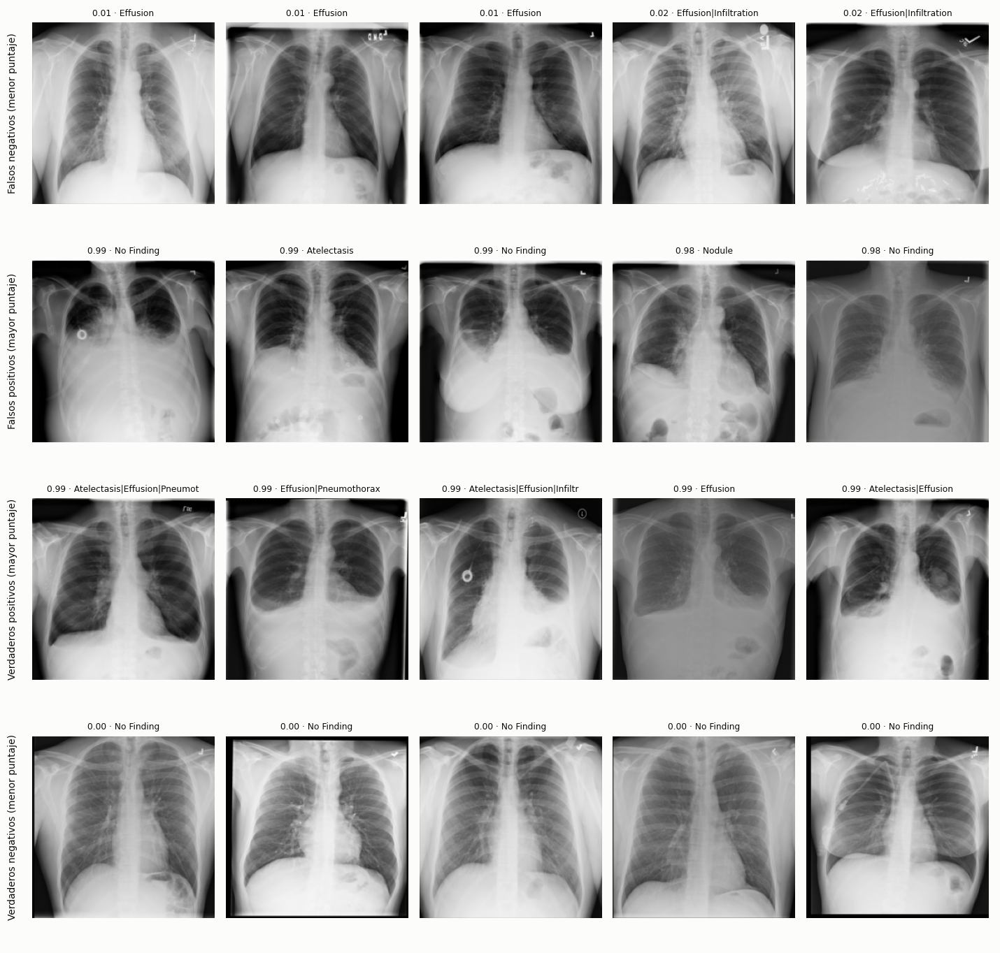
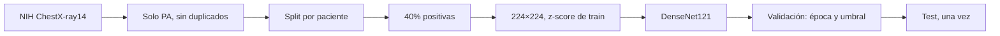
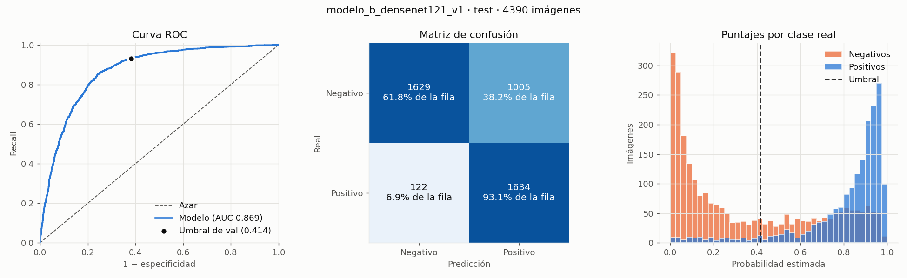

<div align="center">

# Detección de derrame pleural en radiografías de tórax

### Un clasificador que recibe una radiografía de tórax PA y estima si tiene derrame pleural (*Effusion*), entrenado y evaluado con NIH ChestX-ray14

[](https://www.python.org/)
[](https://pytorch.org/)
[](LICENSE)
[]()

[Demo en vivo](https://marcouzis11.github.io/iaproyecto/) · [Informe completo (PDF)](docs/Informe_proceso_Effusion.pdf) · [Reportar un bug](../../issues) · [Pedir una funcionalidad](../../issues)

</div>

---

## Tabla de contenidos

- [Demo](#demo)
- [Sobre el proyecto](#sobre-el-proyecto)
  - [Propuesta formal (Project Charter)](#propuesta-formal-project-charter)
  - [Contexto académico](#contexto-académico)
  - [Construido con](#construido-con)
- [El dataset](#el-dataset)
- [Metodología](#metodología)
- [Resultados](#resultados)
- [Estructura del proyecto](#estructura-del-proyecto)
- [Instalación](#instalación)
- [Uso](#uso)
- [Mejoras para el final](#mejoras-para-el-final)
- [Roadmap](#roadmap)
- [Autores](#autores)
- [Licencia](#licencia)
- [Referencias](#referencias)

---

## Demo

El MVP es un comando de consola: recibe una o más radiografías, las pasa por el modelo ya entrenado y devuelve el puntaje y la clase de cada una, en texto, JSON o CSV. El modelo y cuatro radiografías de ejemplo vienen en el repositorio, así que funciona apenas se instala:

```bash
rx-predecir examples/radiografias/*.png
```

```text
modelo_b_densenet121_v1 · umbral 0.414 (elegido en validación)
00000643_006.png  0.575  Effusion
00004526_023.png  0.345  sin Effusion
00022899_024.png  0.940  Effusion
00030344_002.png  0.186  sin Effusion
```

Las cuatro se eligieron al azar, una por cada celda de la matriz de confusión: `00022899_024` tiene derrame y el modelo lo detecta; `00004526_023` también tiene, pero el modelo no lo ve; `00000643_006` es una falsa alarma y `00030344_002`, un acierto sin derrame ([detalle](examples/radiografias/README.md)). Con `rx-probar` se prueba lo mismo en el navegador, con un mapa de calor de dónde mira el modelo.

Aciertos y errores del modelo en el test oficial (los cinco casos más seguros de cada celda):



**Demo en vivo:** https://marcouzis11.github.io/iaproyecto/ (página estática en `docs/`, se publica con GitHub Pages desde `main`).

---

## Sobre el proyecto

El derrame pleural es líquido acumulado entre el pulmón y la pared del tórax. En una radiografía se ve como una opacidad en las bases que borra los ángulos entre las costillas y el diafragma. Es uno de los hallazgos más frecuentes en pacientes internados, y una herramienta que marque las radiografías sospechosas podría ayudar a priorizar cuáles revisar primero.

El proyecto entrena una red convolucional para responder una sola pregunta: **¿esta radiografía PA tiene la etiqueta *Effusion* en NIH ChestX-ray14?** Se usó transferencia de aprendizaje con DenseNet121, preentrenada en ImageNet, y se compararon varias formas de armar los datos de entrenamiento (modelos A, B y C). Todo el pipeline es reproducible con semilla fija: preparación, separación por paciente, entrenamiento, evaluación con intervalos de confianza y predicción sobre imágenes nuevas.

**Resultado principal:** el modelo final (B) obtiene **F1 0,744** (IC 95%: 0,726 a 0,761) y AUC 0,869 en una submuestra del test oficial de NIH con 40% de positivas, evaluada una sola vez. Supera la referencia sin IA (F1 0,571) pero no llega al 0,80 que la consigna da como ejemplo. Un experimento posterior (modelo C) llegó a 0,784 en otro test, sin que la mejora sea significativa.

Es un prototipo académico: no diagnostica, y con la proporción real de derrames la mayoría de sus alarmas serían falsas.

### Propuesta formal (Project Charter)

**Definición del problema.** Clasificación binaria de imágenes. Entrada: una radiografía de tórax PA (PNG, JPEG o TIFF). Salida: un puntaje entre 0 y 1 y la clase *Effusion* / *sin Effusion*, según un umbral fijado en validación. Un 0 significa que NIH no anotó derrame, no que la radiografía sea normal.

| PEAS | Descripción |
|---|---|
| **Performance** (medida de rendimiento) | F1-Score de la clase positiva en pacientes que el modelo nunca vio, con IC 95%. También AUC, recall, especificidad y precisión. |
| **Environment** (entorno) | Radiografías PA de NIH ChestX-ray14, con etiquetas extraídas automáticamente de informes. |
| **Actuators** (actuadores) | Puntaje y clase por imagen, en consola, JSON o CSV. |
| **Sensors** (sensores) | El archivo de imagen, leído en escala de grises y llevado a 224×224 sin deformar. |

El entorno es parcialmente observable, determinista, episódico, estático y de un solo agente; en uso, el modelo es un agente reactivo simple con la regla "si el puntaje es ≥ 0,414, Effusion". Cada dimensión está justificada en [metodología](docs/METODOLOGIA.md#el-problema-como-agente).

**Origen y naturaleza de los datos.** NIH ChestX-ray14: 112.120 radiografías frontales de 30.805 pacientes, con 14 hallazgos etiquetados por procesamiento de lenguaje natural sobre los informes. Se usan solo las 67.298 PA válidas (ver [El dataset](#el-dataset)).

**Métricas de éxito y baseline.**
- **Métrica principal:** F1-Score de la clase positiva, con IC 95% por paciente. Se informan también el recall y la especificidad, porque para priorizar estudios perder un derrame es más grave que una falsa alarma.
- **Meta de referencia:** F1 > 0,80, el ejemplo de la consigna.
- **Baseline sin IA:** hoy se leen todas las radiografías, que equivale a marcarlas todas como positivas: F1 0,571 con 40% de positivos.
- **Protocolo:** la época, el umbral y el modelo se eligen en validación; el test se evalúa una sola vez.

Cuándo se fijó cada una y el punto de operación con recall ≥ 95% están en [metodología](docs/METODOLOGIA.md#métricas-de-éxito-y-protocolo).

**Límites del alcance (out of scope).**
- Vistas AP y laterales, y radiografías de otros equipos u hospitales: el modelo solo se validó con PA de NIH.
- Más de un hallazgo por imagen (multietiqueta) y localización del derrame en la imagen.
- DICOM: el lector acepta PNG, JPEG y TIFF.
- Uso clínico o diagnóstico. No hay validación con radiólogos ni con la proporción real de casos.
- API, usuarios o base de datos: el MVP es el comando de consola, y `rx-probar` es una página local para probarlo.

### Contexto académico

- **Asignatura:** Inteligencia Artificial, Ingeniería en Informática
- **Institución:** Facultad de Ingeniería, Centro Regional Universitario Córdoba - IUA, Universidad de la Defensa Nacional
- **Cohorte / año:** 2026
- **Docente:** Ing. Hernando Alexis González
- **Modalidad:** grupal, entrega de MVP funcional

### Construido con

- [Python 3.11](https://www.python.org/) con `venv` y `pip`
- [PyTorch](https://pytorch.org/) y [torchvision](https://pytorch.org/vision/): DenseNet121 preentrenada, entrenamiento e inferencia
- [NumPy](https://numpy.org/): arrays de imágenes, métricas y bootstrap
- [Pillow](https://python-pillow.org/): lectura y redimensionado de imágenes
- [matplotlib](https://matplotlib.org/): gráficos de evaluación
- [Jupyter](https://jupyter.org/): notebooks de análisis exploratorio, preparación y pruebas

---

## El dataset

| Campo | Detalle |
|---|---|
| Fuente | [NIH ChestX-ray14](https://nihcc.app.box.com/v/ChestXray-NIHCC), NIH Clinical Center (Wang et al., CVPR 2017) |
| Registros | 112.120 radiografías de 30.805 pacientes; 67.298 PA válidas; 6.589 PA con Effusion (9,8%) |
| Variables | Imagen PNG 1024×1024 en grises. Metadatos: `Image Index`, `Patient ID`, `Finding Labels`, `View Position`, `Follow-up #`, edad y sexo. El modelo solo usa la imagen |
| Variable objetivo | `Effusion`: 1 si las etiquetas de la imagen incluyen *Effusion* (sola o con otros hallazgos), 0 si no |
| Período / cobertura | Estudios de 1992 a 2015 del NIH Clinical Center (EE. UU.); CSV `Data_Entry_2017_v2020.csv` |
| Licencia del dataset | Uso libre, con atribución: enlace al sitio del NIH, cita del paper y reconocimiento al NIH Clinical Center |

La descarga pesa unos 42 GB y no está en el repositorio. Para entrenar, se baja de Box y se deja en `data/raw/nih/` el CSV, las listas `train_val_list.txt` y `test_list.txt` y las 12 carpetas `images_*`; la guía está en [preparación de datos](docs/PREPARAR_DATOS.md). Para recalcular los resultados o predecir no hace falta.

**Sesgos y limitaciones conocidas:**
- **Etiquetas con ruido:** salen de procesar informes con NLP, no de un radiólogo mirando la imagen. Varios falsos positivos del modelo parecen derrames reales etiquetados como otra cosa.
- **Pacientes internados:** las positivas vienen más de pacientes con muchos estudios previos, que suelen tener cables, catéteres o vías. El modelo puede aprender esas señales además del derrame.
- **Test oficial distinto de train:** el 53% de sus positivas son de pacientes con 10 o más estudios previos, contra 22% en `train_val`.
- **Un solo hospital:** no hay evidencia de cómo generaliza a otros equipos.

---

## Metodología



1. **Limpieza:** solo PA (se excluyen 44.810 AP) y sin duplicados por hash de píxeles. Quedan 67.298 radiografías.
2. **Separación por paciente:** test es la lista oficial de NIH; validación, el 15% de los pacientes de `train_val`. Ningún paciente se repite entre conjuntos.
3. **40% de positivas** en train, validación y test, por pedido del profesor: todas las positivas y negativas al azar con semilla fija (65% sin hallazgos y 35% con otros, máximo 3 por paciente).
4. **Transformación:** grises, 224×224 sin deformar y z-score con la media y el desvío de train. Aumento de datos solo en train: rotación, escala y desplazamiento leves, sin espejar.
5. **Modelo:** DenseNet121 preentrenada en ImageNet, con una sola salida. Pérdida BCE, AdamW (lr 1e-4), lotes de 32 y early stopping por AUC de validación.
6. **Validación y test:** validación elige la época, el umbral (máximo F1) y el modelo; test se evalúa una sola vez. Intervalos por bootstrap de pacientes y comparaciones pareadas con α = 0,05.

Se compararon cuatro formas de llegar a 40% de positivas en train:

| Modelo | Train | Por qué | Tiempo |
|---|---|---|---|
| **A** · sacar negativas | 10.270 imágenes (4.108 positivas) | Lo más simple: submuestrear negativas | 48 min |
| **B** · repetir positivas | 22.594 imágenes; cada positiva 3 veces por época | Usa más negativas distintas sin bajar del 40% | 79 min |
| **Control** · como A, datos v2 | 7.252 imágenes (2.901 positivas) | Referencia justa para C, con la misma cantidad de datos | 30 min |
| **C** · negativas como el test oficial | 7.252 imágenes (2.901 positivas) | Negativas con la mezcla de estudios previos del test oficial | 31 min |

Tiempos en una Mac M4 con MPS. Configuraciones en [`configs/`](configs/).

Por qué se tomó cada decisión, con la estadística que la respalda, está en [metodología y decisiones](docs/METODOLOGIA.md): análisis exploratorio, tabla de decisiones, preprocesamiento, elección de la red y de la validación. El EDA completo está en el notebook [`00_eda_nih_effusion.ipynb`](notebooks/00_eda_nih_effusion.ipynb), y la relación con el material de clase, en [trazabilidad](docs/TRAZABILIDAD_CLASES.md).

---

## Resultados

Modelo B en una **submuestra del test oficial de NIH**: 4.390 radiografías de 1.686 pacientes, con todas las positivas PA de la lista oficial y negativas elegidas como en train (40% de positivas, 65% de negativas sin hallazgos, máximo 3 por paciente). Umbral 0,414, fijado en validación. Todas las cifras de esta sección se recalculan sin NIH con `rx-recalcular` (ver [Uso](#3-recalcular-los-resultados-sin-nih)).

| Métrica | Baseline: siempre positivo | Modelo final (B) |
|---|---|---|
| **F1-Score** (IC 95%) | 0,571 | **0,744** (0,726 a 0,761) |
| AUC | 0,500 | 0,869 (0,858 a 0,880) |
| Recall | 100% | 93,1% |
| Especificidad | 0% | 61,8% |
| Precisión | 40,0% | 61,9% |
| Exactitud | 40,0% | 74,3% |



F1 de todos los modelos (validación es optimista porque ahí se eligieron la época y el umbral):

| Modelo | Conjunto | F1 (IC 95%) | AUC |
|---|---|---|---|
| A | Validación | 0,795 (0,769 a 0,821) | 0,898 |
| B | Validación | 0,800 (0,773 a 0,825) | 0,905 |
| **B** | **Test oficial** | **0,744 (0,726 a 0,761)** | **0,869** |
| Control | Test nuevo (1.313 imágenes) | 0,775 (0,729 a 0,814) | 0,895 |
| C | Test nuevo (1.313 imágenes) | 0,784 (0,736 a 0,823) | 0,897 |
| Siempre positivo | Cualquiera con 40% de positivos | 0,571 | 0,500 |

**Lectura de los resultados:**
- **El modelo aprende algo real:** AUC 0,87 en pacientes que nunca vio, y el intervalo del F1 queda entero por encima del baseline.
- **No alcanza el 0,80.** En validación B daba 0,800 y en test cae a 0,744: la especificidad baja de 81% a 62%. Parte de la caída es la población del test oficial, con muchos más pacientes con 10 o más estudios previos.
- **Usa en parte la señal "paciente internado":** entre las negativas, el puntaje sube con los estudios previos (Spearman 0,49 en test); entre las positivas no hay relación.
- **El modelo C bajó los falsos positivos** de forma significativa (26 menos), pero su F1 (0,784) no es significativamente mayor que el del control (0,775).
- **El F1 depende de la proporción de positivos:** con la real de NIH (9,8%) sería 0,34, y 4 de cada 5 alarmas serían falsas. Sirve, como mucho, para priorizar estudios.

El análisis completo está en [metodología](docs/METODOLOGIA.md#análisis-crítico-de-los-resultados), [resultados de A y B](docs/RESULTADOS_MODELOS.md), [modelo C](docs/MODELO_C.md) y el [informe en PDF](docs/Informe_proceso_Effusion.pdf).

---

## Estructura del proyecto

```text
.
├── pyproject.toml          # Paquete, dependencias fijadas y comandos rx-*
├── requirements.txt        # Entorno exacto del entrenamiento (macOS arm64, Python 3.11)
├── configs/                # JSON de preparación y entrenamiento, y SHA-256 de los datos preparados
├── data/                   # Fuera de git: NIH descargado (raw/) y preparaciones (processed/)
├── models/                 # Pesos, predicciones y reportes de A, B, control y C, y sus comparaciones
├── src/rx_torax/           # Código: data/, preprocessing/, training/, evaluation/ e inference/
├── notebooks/              # EDA de NIH, preparación y pruebas
├── tests/                  # Pruebas automáticas (unittest)
├── scripts/                # flujo_completo.sh y preparar.ps1
├── examples/               # 4 radiografías de ejemplo y carga de arrays
├── docs/                   # Página de GitHub Pages, informe, figuras y documentación
└── .github/workflows/      # Integración continua en cada push
```

Los cuatro modelos están en git con sus pesos (28 MB cada uno), sus predicciones por imagen y sus reportes, así que cualquiera se usa apenas se clona y los resultados se recalculan sin NIH. Los datos preparados quedan fuera de git porque pesan varios GB. Las ramas y la organización del trabajo están en [organización](docs/ORGANIZACION.md).

---

## Instalación

### Prerrequisitos

- Python 3.11, 3.12 o 3.13
- Git
- Unos 2 GB libres para las dependencias (PyTorch). Para entrenar, además, 45 GB para NIH y 10 GB para los datos preparados.

### Pasos

```bash
# 1. Cloná el repositorio
git clone https://github.com/Marcouzis11/iaproyecto.git
cd iaproyecto

# 2. Creá el entorno virtual
python3.11 -m venv .venv          # Windows: py -3.11 -m venv .venv

# 3. Activalo
source .venv/bin/activate         # Windows (PowerShell): .venv\Scripts\Activate.ps1

# 4. Instalá el proyecto y sus dependencias (versiones fijadas)
python -m pip install -e .
```

**De dónde sale cada lista de versiones.** `pyproject.toml` fija las cinco dependencias directas y es lo que instala el paso 4, en cualquier sistema. `requirements.txt` es el entorno exacto donde se entrenaron y evaluaron los modelos, con las dependencias indirectas: se generó en **macOS arm64 (Apple M4) con Python 3.11**, como indica su primera línea. Para reproducir ese entorno, el paso 4 es `python -m pip install -r requirements.txt -e .`. Para los notebooks, `python -m pip install -e ".[notebooks]"`.

Instalación verificada desde cero en macOS (Apple M4, Python 3.11) y en Windows 11 (Python 3.13), con `pip` y con [uv](https://docs.astral.sh/uv/) (`uv venv --python 3.11` y `uv pip install -r requirements.txt -e .`): las pruebas pasan y `rx-predecir` da los mismos puntajes en los dos sistemas.

**Variables de entorno:** no hace falta ninguna; las rutas y parámetros están en `configs/`. [`.env.example`](.env.example) lista las opcionales de Python y PyTorch, sin claves. El dispositivo se elige solo (CUDA, MPS o CPU) y se fuerza con `--dispositivo cpu`.

**Comprobar la instalación:** `python -m unittest discover -s tests` corre 61 pruebas en alrededor de un minuto, sin el dataset: usan datos sintéticos, el modelo final con las radiografías de ejemplo y las predicciones versionadas ([detalle](docs/VALIDACION.md)).

**Integración continua:** en cada push y pull request, GitHub Actions instala el proyecto con las versiones fijadas, corre estas pruebas, recalcula con `rx-recalcular` todos los resultados y ejecuta `rx-predecir` con los cuatro modelos sobre las radiografías de ejemplo. Corre en Ubuntu con Python 3.11 y en Windows con Python 3.13 ([`.github/workflows/tests.yml`](.github/workflows/tests.yml)).

---

## Uso

Con el entorno activado, desde la raíz del repositorio.

### 1. Predecir sobre radiografías nuevas (MVP)

```bash
rx-predecir --json examples/radiografias/00022899_024.png
```

- Sin `--json` imprime una línea por imagen (ver [Demo](#demo)); con `--json`, el modelo, el umbral y, por imagen, el puntaje, si es positiva y la clase. `--salida archivo.csv` lo guarda en CSV.
- Acepta PNG, JPEG y TIFF. Si un archivo no se puede leer, termina con un mensaje `error:` y código 1.
- `--modelo` permite usar otro modelo; por defecto usa `models/modelo_b_densenet121_v1`.
- Solo tiene sentido con radiografías de tórax PA.

### 2. Probar el modelo en el navegador

```bash
rx-probar
```

Abre una página local (http://127.0.0.1:8765) donde se arrastran radiografías y se ve, para cada una, el puntaje, la clase y un mapa de calor (Grad-CAM) con las zonas que más empujan el puntaje hacia derrame. Un control permite mover el umbral y ver cómo cambia la decisión. Todo corre en la computadora: las imágenes no se suben a internet. Usa la misma transformación y el mismo umbral que `rx-predecir`; `--puerto` cambia el puerto y `--no-abrir` evita abrir el navegador.

### 3. Recalcular los resultados sin NIH

```bash
rx-recalcular
```

```text
modelo_b_densenet121_v1 · test · 4390 imágenes · F1 0.744 (0.726 a 0.761) · AUC 0.869 · recall 93.1% · especificidad 61.8% · coincide
10 de 10 resultados coinciden con sus report.json.
```

Cada evaluación guarda una fila por imagen en `models/<modelo>/evaluacion_<conjunto>/predicciones_<conjunto>.csv`: nombre, paciente, etiqueta, puntaje y decisión. `rx-recalcular` rehace con esos CSV las métricas, los intervalos por paciente y las comparaciones pareadas, con el mismo código que `rx-evaluar` y `rx-comparar`, y termina con error si algún número no coincide con su `report.json`. Son 7 evaluaciones (A, B, control y C en validación; B, control y C en test, porque se eligió B antes de abrirlo) y 3 comparaciones. Para otros cortes, como edad o sexo, se cruzan los CSV por nombre de imagen con `Data_Entry_2017_v2020.csv` de NIH (9 MB).

### 4. Usar los modelos A, control y C

```bash
rx-predecir --modelo models/modelo_c_v2_densenet121 examples/radiografias/*.png
rx-probar --modelo models/modelo_a_densenet121_v1
```

Los pesos de los cuatro modelos vienen en el repositorio, en `models/<modelo>/modelo.pt`, con el umbral que cada uno eligió en validación. `--modelo` los cambia en `rx-predecir` y en `rx-probar`; sin esa opción se usa el modelo final (B).

### 5. Entrenar y evaluar

```bash
scripts/flujo_completo.sh demo    # sin NIH: 120 imágenes sintéticas, de punta a punta en menos de un minuto
scripts/flujo_completo.sh nih     # con NIH en data/raw/nih/: preparar, entrenar B, evaluar val y test y predecir
```

El modo demo prueba que el código corre; con datos al azar el modelo no aprende nada, y es lo esperable. El modo NIH deja el modelo en `models/reproduccion_modelo_b`, sin pisar el versionado. En Windows, correrlos desde Git Bash. Paso por paso, y para los demás modelos:

| Paso | Comando |
|---|---|
| Preparar datos de A | `rx-preparar --config configs/nih.json` |
| Preparar datos de B | `rx-preparar --config configs/nih_modelo_b.json` |
| Preparar control y C | `rx-preparar --config configs/nih_v2_control.json` y `configs/nih_v2_c.json` |
| Verificar que los datos de B sean los del equipo | `rx-verificar-datos data/processed/nih_effusion_pa_modelo_b_v1` |
| Entrenar | `rx-entrenar --config configs/modelo_b.json --salida models/otro_nombre` (o `modelo_a`, `modelo_control_v2`, `modelo_c_v2`) |
| Evaluar en validación | `rx-evaluar --modelo models/otro_nombre --conjunto val` |
| Comparar dos modelos | `rx-comparar --modelos models/x models/y --nombres X Y --salida models/comparacion` |
| Evaluar en test, una vez | `rx-evaluar --modelo models/otro_nombre --conjunto test` |

Cada comando guarda un `report.json` con la configuración, las versiones de las librerías y las métricas. Con la misma semilla, los datos preparados son idénticos; los pesos entrenados en GPU o MPS pueden variar levemente entre corridas, por operaciones no deterministas del hardware.

### 6. Notebooks

`python -m notebook notebooks/00_eda_nih_effusion.ipynb`, con las dependencias de `.[notebooks]`, abre el análisis exploratorio de NIH, guardado con sus resultados. `01_preparacion_radiografias.ipynb` y `02_pruebas_pipeline.ipynb` hacen la preparación en celdas y la prueban, en modo demo sin el dataset. Ver [notebooks](notebooks/README.md).

---

## Mejoras para el final

Cada integrante toma una mejora, la trabaja en su fork y la compara contra el modelo B con los mismos datos y el mismo protocolo:

| Integrante | Mejora | Qué responde |
|---|---|---|
| Tiziano Bertorello | Llegar a F1 0,80 | Qué cambio separa mejor las clases sin tocar el protocolo |
| Marcos Agustín García Mombello | Otra arquitectura (EfficientNet-B0) | Si DenseNet121 era la mejor opción para estos datos |
| Martin Mousist | Modelo B con 3 semillas | Cuánto cambia el resultado entre entrenamientos |

Las tres parten del tag `base-final`. Cómo se organizan los forks, los datos compartidos y las reglas para que los resultados sean comparables está en [mejoras para el final](docs/MEJORAS_FINAL.md).

---

## Roadmap

- [ ] Anotar a mano dispositivos (cables, catéteres) en una muestra de test, para medir cuánto los usa el modelo.
- [ ] Validación externa con otro dataset, por ejemplo [CheXpert](https://stanfordmlgroup.github.io/competitions/chexpert/), que el preparador ya sabe leer.
- [ ] Probar resoluciones mayores que 224×224, donde los derrames chicos no se pierdan.
- [ ] Medir F1 y especificidad por sexo y por edad en el test oficial, como ya se hizo por estudios previos, con las predicciones guardadas y sin volver a evaluar el modelo.
- [ ] API REST con FastAPI sobre `rx-predecir`.

---

## Autores

- **Tiziano Bertorello**: [GitHub](https://github.com/tiziberto)
- **Marcos Agustín García Mombello**: [GitHub](https://github.com/Marcouzis11)
- **Martin Mousist**: [GitHub](https://github.com/MartinMousist)

---

## Licencia

El código está bajo la licencia [MIT](LICENSE). Las radiografías de NIH ChestX-ray14, incluidas las cuatro de [`examples/radiografias/`](examples/radiografias/), tienen sus propias condiciones: uso libre con atribución al NIH Clinical Center y cita del paper de Wang et al. (2017).

---

## Referencias

- Wang X., Peng Y., Lu L., Lu Z., Bagheri M., Summers R. M. *ChestX-ray8: Hospital-scale Chest X-ray Database and Benchmarks on Weakly-Supervised Classification and Localization of Common Thorax Diseases.* CVPR 2017. Dataset del [NIH Clinical Center](https://nihcc.app.box.com/v/ChestXray-NIHCC).
- Huang G., Liu Z., van der Maaten L., Weinberger K. Q. *Densely Connected Convolutional Networks.* CVPR 2017.
- Rajpurkar P. et al. *CheXNet: Radiologist-Level Pneumonia Detection on Chest X-Rays with Deep Learning.* arXiv:1711.05225, 2017.
