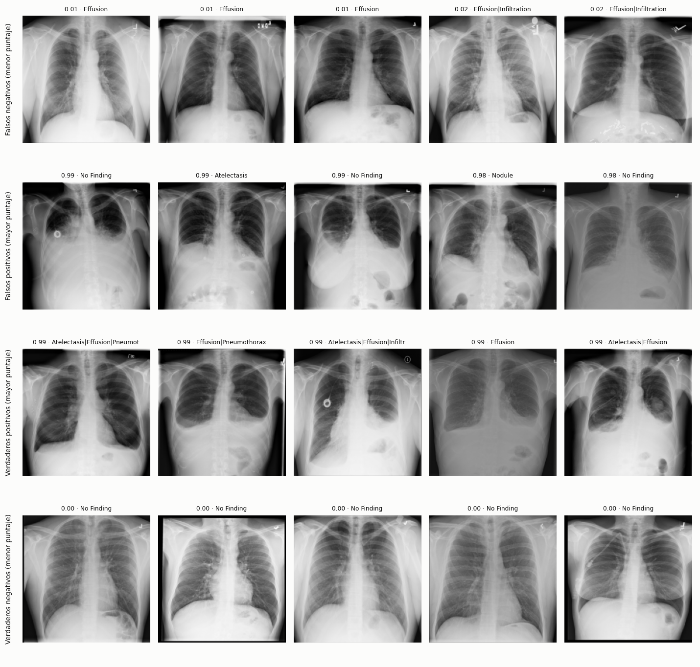
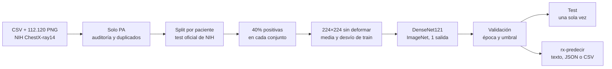
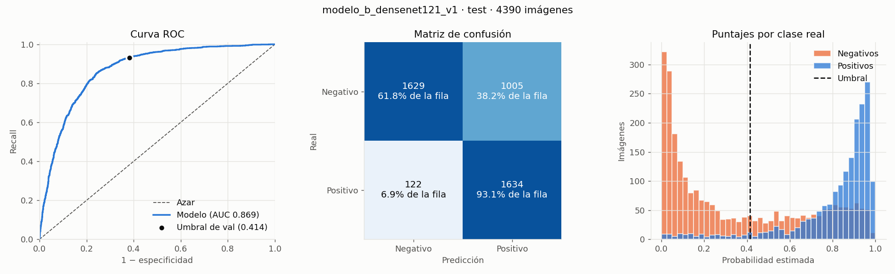

<div align="center">

# Detección de derrame pleural en radiografías de tórax

### Un clasificador que recibe una radiografía de tórax PA y estima si tiene derrame pleural (*Effusion*), entrenado y evaluado con NIH ChestX-ray14

[](https://www.python.org/)
[](https://pytorch.org/)
[](LICENSE)
[]()

[Demo en vivo](https://marcouzis11.github.io/iaproyecto/) · [Informe completo (PDF)](docs/Informe_proceso_Effusion.pdf) · [Reportar un bug](../../issues) · [Pedir una funcionalidad](../../issues)

</div>

---

## Tabla de contenidos

- [Demo](#demo)
- [Sobre el proyecto](#sobre-el-proyecto)
  - [Propuesta formal (Project Charter)](#propuesta-formal-project-charter)
  - [Contexto académico](#contexto-académico)
  - [Construido con](#construido-con)
- [El dataset](#el-dataset)
- [Metodología](#metodología)
- [Resultados](#resultados)
- [Estructura del proyecto](#estructura-del-proyecto)
- [Instalación](#️-instalación)
- [Uso](#️-uso)
- [Roadmap](#️-roadmap)
- [Autores](#autores)
- [Licencia](#licencia)
- [Agradecimientos y referencias](#agradecimientos-y-referencias)

---

## Demo

El MVP es un comando de consola: recibe una o más radiografías, las pasa por el modelo ya entrenado y devuelve el puntaje y la clase de cada una, en texto o en JSON. El modelo y cuatro radiografías de ejemplo vienen en el repositorio, así que funciona apenas se instala:

```bash
rx-predecir --json examples/radiografias/00022899_024.png examples/radiografias/00004526_023.png
```

```json
{
  "modelo": "models/modelo_b_densenet121_v1",
  "hallazgo": "Effusion",
  "umbral": 0.413918,
  "predicciones": [
    {
      "imagen": "examples/radiografias/00022899_024.png",
      "puntaje": 0.939869,
      "positivo": true,
      "clase": "Effusion"
    },
    {
      "imagen": "examples/radiografias/00004526_023.png",
      "puntaje": 0.345016,
      "positivo": false,
      "clase": "sin Effusion"
    }
  ]
}
```

La primera tiene derrame y el modelo lo detecta. La segunda también tiene derrame, pero el modelo no lo ve: es un falso negativo. Las cuatro de ejemplo se eligieron al azar, una por cada celda de la matriz de confusión ([detalle](examples/radiografias/README.md)).

Aciertos y errores del modelo en el test oficial (los cinco casos más seguros de cada celda):



**Demo en vivo:** https://marcouzis11.github.io/iaproyecto/ (página estática en `docs/`, se publica con GitHub Pages desde `main`).

---

## Sobre el proyecto

El derrame pleural es líquido acumulado entre el pulmón y la pared del tórax. En una radiografía se ve como una opacidad en las bases que borra los ángulos entre las costillas y el diafragma. Es uno de los hallazgos más frecuentes en pacientes internados, y una herramienta que marque las radiografías sospechosas podría ayudar a priorizar cuáles revisar primero.

El proyecto entrena una red convolucional para responder una sola pregunta: **¿esta radiografía PA tiene la etiqueta *Effusion* en NIH ChestX-ray14?** Se usó transferencia de aprendizaje con DenseNet121, preentrenada en ImageNet, y se compararon tres formas de armar los datos de entrenamiento (modelos A, B y C). Todo el pipeline es reproducible con semilla fija: preparación, separación por paciente, entrenamiento, evaluación con intervalos de confianza y predicción sobre imágenes nuevas.

**Resultado principal:** el modelo final (B) obtiene **F1 0,744** (IC 95%: 0,726 a 0,761) y AUC 0,869 en una submuestra del test oficial de NIH con 40% de positivas, evaluada una sola vez. Supera la referencia sin IA (F1 0,571) pero no llega al 0,80 que la consigna da como ejemplo. Un experimento posterior (modelo C) llegó a 0,784 en otro test, sin que la mejora sea significativa.

Es un prototipo académico: no diagnostica, y con la proporción real de derrames la mayoría de sus alarmas serían falsas.

### Propuesta formal (Project Charter)

**Definición del problema.** Clasificación binaria de imágenes. Entrada: una radiografía de tórax PA (PNG, JPEG o TIFF). Salida: un puntaje entre 0 y 1 y la clase *Effusion* / *sin Effusion*, según un umbral fijado en validación. Un 0 significa que NIH no anotó derrame, no que la radiografía sea normal.

| PEAS | Descripción |
|---|---|
| **Performance** (medida de rendimiento) | F1-Score de la clase positiva en pacientes que el modelo nunca vio, con IC 95%. También AUC, recall, especificidad y precisión. |
| **Environment** (entorno) | Radiografías PA de NIH ChestX-ray14, con etiquetas extraídas automáticamente de informes. |
| **Actuators** (actuadores) | Puntaje y clase por imagen, en consola, JSON o CSV. |
| **Sensors** (sensores) | El archivo de imagen, leído en escala de grises y llevado a 224×224 sin deformar. |

Propiedades del entorno, con las seis dimensiones de clase (slides 07, pp. 42-48):

| Dimensión | Entorno | Por qué |
|---|---|---|
| Observabilidad | Parcialmente observable | Una sola proyección a 224×224, sin historia clínica y con etiquetas ruidosas |
| Determinismo | Determinista | La misma imagen da siempre el mismo puntaje; la incertidumbre está en las etiquetas |
| Episodicidad | Episódico | Cada estudio se decide solo y no condiciona al siguiente |
| Dinamismo | Estático | La imagen no cambia mientras el agente decide |
| Continuidad | Percepción continua, acción discreta | Píxeles y puntaje continuos; la decisión tiene dos clases |
| Agentes | Individual | No hay otros agentes en el entorno |

Es un agente que aprende durante el entrenamiento (p. 54); en uso es un agente reactivo simple (p. 50), con la regla "si el puntaje es ≥ 0,414, Effusion".

**Origen y naturaleza de los datos.** NIH ChestX-ray14: 112.120 radiografías frontales de 30.805 pacientes, con 14 hallazgos etiquetados por procesamiento de lenguaje natural sobre los informes. Se usan solo las 67.298 PA válidas. Los sesgos y la limpieza se describen en [El dataset](#el-dataset) y [Metodología](#metodología).

**Métricas de éxito y baseline.**
- **Métrica principal:** F1-Score de la clase positiva. La consigna lo da como ejemplo; lo elegimos porque, con 40% de positivos, no se infla como la exactitud.
- **Costo de los errores:** F1 pesa igual una falsa alarma que un derrame perdido, pero para priorizar estudios perder un derrame es más grave (slides 09, p. 10). Por eso se informa también el recall y un punto de operación con recall ≥ 95%, elegido en validación: umbral 0,136, especificidad 59,5% (en validación).
- **Meta de referencia:** F1 > 0,80, el ejemplo de la consigna.
- **Baseline sin IA:** hoy se leen todas las radiografías, que equivale a marcarlas todas como positivas: F1 0,571 con 40% de positivos (recall 100%, precisión 40%). Marcarlas todas como negativas da F1 0.
- **Protocolo:** el umbral y el modelo se eligen en validación; el test se evalúa una sola vez. La época y el modelo se eligen por AUC de validación, que no depende del umbral; con el F1 de validación la elección habría sido la misma (B 0,800, A 0,795).

**Cronología.** La consigna pide el Charter antes de codificar (p. 3). La primera propuesta es del 18/10 (`docs/PLAN_INICIAL.md`) y se rehízo el 21/10. El problema final, *Effusion* con 40% de positivos, se definió el 01/11 después del EDA. A y B se entrenaron y evaluaron el 2 y el 3/11. El F1 como métrica de éxito quedó escrito el 4/11, antes de evaluar el modelo C; el Charter con PEAS se completó el 10/11. Para A y B, el 0,80 se adoptó como referencia después de evaluar; para C se fijó antes.

**Límites del alcance (out of scope).**
- Vistas AP y laterales, y radiografías de otros equipos u hospitales: el modelo solo se validó con PA de NIH.
- Más de un hallazgo por imagen (multietiqueta) y localización del derrame en la imagen.
- DICOM: el lector acepta PNG, JPEG y TIFF.
- Uso clínico o diagnóstico. No hay validación con radiólogos ni con la proporción real de casos.
- API, interfaz gráfica, usuarios o base de datos: el MVP es el comando de consola. La página de `docs/` es solo de presentación.

### Contexto académico

- **Asignatura:** Inteligencia Artificial, Ingeniería en Informática
- **Institución:** Facultad de Ingeniería, Centro Regional Universitario Córdoba - IUA, Universidad de la Defensa Nacional
- **Cohorte / año:** 2026
- **Docente:** Ing. Hernando Alexis González
- **Modalidad:** grupal, entrega de MVP funcional

### Construido con

- [Python 3.11](https://www.python.org/) con `venv` y `pip`
- [PyTorch](https://pytorch.org/) y [torchvision](https://pytorch.org/vision/): DenseNet121 preentrenada, entrenamiento e inferencia
- [NumPy](https://numpy.org/): arrays de imágenes, métricas y bootstrap
- [Pillow](https://python-pillow.org/): lectura y redimensionado de imágenes
- [matplotlib](https://matplotlib.org/): gráficos de evaluación
- [Jupyter](https://jupyter.org/): notebooks de análisis exploratorio, preparación y pruebas

---

## El dataset

| Campo | Detalle |
|---|---|
| Fuente | [NIH ChestX-ray14](https://nihcc.app.box.com/v/ChestXray-NIHCC), NIH Clinical Center (Wang et al., CVPR 2017) |
| Registros | 112.120 radiografías de 30.805 pacientes; 67.298 PA válidas; 6.589 PA con Effusion (9,8%) |
| Variables | Imagen PNG 1024×1024 en grises. Metadatos: `Image Index`, `Patient ID`, `Finding Labels`, `View Position`, `Follow-up #`, edad y sexo. El modelo solo usa la imagen |
| Variable objetivo | `Effusion`: 1 si las etiquetas de la imagen incluyen *Effusion* (sola o con otros hallazgos), 0 si no |
| Período / cobertura | Estudios de 1992 a 2015 del NIH Clinical Center (EE. UU.); CSV `Data_Entry_2017_v2020.csv` |
| Licencia del dataset | Uso libre, con atribución: enlace al sitio del NIH, cita del paper y reconocimiento al NIH Clinical Center |

La descarga pesa unos 42 GB y no está en el repositorio. Para reproducir el entrenamiento, descargar del enlace de Box y dejar en `data/raw/nih/`:

```text
data/raw/nih/
├── Data_Entry_2017_v2020.csv
├── train_val_list.txt
├── test_list.txt
└── images_001/ a images_012/     # los 12 archivos images_*.tar.gz descomprimidos
```

El preparador busca cada imagen por nombre dentro de `data/raw/nih/`, así que la estructura de subcarpetas no importa. La guía completa está en [preparación de datos](docs/PREPARAR_DATOS.md).

**Sesgos y limitaciones conocidas:**
- **Etiquetas con ruido:** salen de procesar informes con NLP, no de un radiólogo mirando la imagen. Varios falsos positivos del modelo parecen derrames reales etiquetados como otra cosa.
- **Pacientes internados:** las positivas vienen más de pacientes con muchos estudios previos, que suelen tener cables, catéteres o vías. El modelo puede aprender esas señales además del derrame.
- **Test oficial distinto de train:** el 53% de sus positivas son de pacientes con 10 o más estudios previos, contra 22% en `train_val`.
- **Un solo hospital:** no hay evidencia de cómo generaliza a otros equipos.

---

## Metodología



### Análisis exploratorio

- **Pacientes:** el 84% de las radiografías es de pacientes con más de un estudio, y las de una misma persona se parecen. Por eso se separa por paciente.
- **Desbalance:** solo el 9,8% de las PA tiene Effusion (15,8% en el test oficial); entropía de Shannon 0,46 e índice de Gini 0,18 (slides 05, p. 7). Por pedido del profesor, train, validación y test tienen 40% de positivos (Shannon 0,97, Gini 0,48). En clase se balancea solo train (slides 06, pp. 29, 31 y 35), así que precisión y F1 salen más altos que con la proporción real: ver [Resultados](#resultados).
- **Vistas:** 44.810 radiografías son AP. Suelen ser placas portátiles de pacientes en cama. Con las medidas de asociación de clase (slides 04, p. 47), la vista casi no se asocia con Effusion (φ = 0,08, despreciable) pero sí con tener 10 o más estudios previos (φ = 0,28, débil): son otra población, así que se excluyeron.
- **Primer intento descartado:** con *Pneumothorax* había 3,6% de positivos en train y 13,9% en test, demasiado pocos. Se cambió a *Effusion* ([resumen](docs/SPLITS_NIH_PNEUMOTHORAX.md)).
- **Archivos:** al auditar la descarga apareció una carpeta `images_010` que era copia de otra; se volvió a bajar.
- **Edad y sexo:** parecidos entre positivas y negativas (edad media 51 contra 47 años en train; 54–55% hombres en los dos grupos). Correlación punto biserial de la edad 0,15 (débil) y φ del sexo 0,005 (despreciable): no se balancea por ellas.
- **Estudios previos:** punto biserial 0,25 con Effusion en train (moderada). Es un posible atajo, que después se midió en el modelo.
- **Dispositivos:** en una muestra revisada a ojo, se ven cables o catéteres en ~30% de las positivas y ~13% de las negativas.
- **Faltantes y outliers:** el CSV no tiene faltantes (0 en las 11 columnas). Con IQR y ±3σ (slides 04, pp. 50-51) sobre el brillo y el contraste de cada imagen de train se marcan placas lavadas, sobreexpuestas o con bordes negros, en proporción parecida en las dos clases: son placas legítimas y se conservan. Apareció un solo error, una placa lateral etiquetada como PA (`00008347_002.png`, negativa de train), que quedó documentado.

Todo este análisis, con sus tablas y gráficos y la decisión que sale de cada uno, está en el notebook [`00_eda_nih_effusion.ipynb`](notebooks/00_eda_nih_effusion.ipynb), que se ve con sus resultados directamente en GitHub. El detalle de los conjuntos está en [train, validación y test](docs/SPLITS_NIH_EFFUSION.md).

### Decisiones y la estadística que las respalda

| Decisión | Estadística que la respalda | Notebook 00 |
|---|---|---|
| Separar por paciente | El 84% de las radiografías es de pacientes con más de un estudio | Sección 1 |
| Usar solo PA | Vista AP × Effusion: φ = 0,08, despreciable. Vista AP × 10 o más estudios previos: φ = 0,28, débil. AP es otra población, no un problema de prevalencia | Sección 3 |
| Effusion como hallazgo | 6.589 positivas PA, la segunda cantidad después de Infiltration (9.353), que es una etiqueta poco específica. Pneumothorax se descartó: 3,6% de positivas en train contra 13,9% en test | Sección 4 |
| 40% de positivas en los tres conjuntos | Pedido del profesor. La proporción real es 9,8% (Shannon 0,46, Gini 0,18); con 40%, Shannon 0,97 y Gini 0,48. Con la proporción real, el F1 de B sería 0,34 | Secciones 2 y 6 |
| Negativas: 65% sin hallazgos y 35% con otros | Es la mezcla de las negativas PA: 64,7% en todas, 67,1% solo en `train_val` | Sección 5 |
| Máximo 3 negativas por paciente | El 14% de los pacientes aporta el 47% de las negativas: sin tope, pocos pacientes dominarían la clase | Sección 5 |
| No balancear por edad ni sexo | Edad × Effusion: punto biserial 0,15, débil. Sexo × Effusion: φ = 0,005, despreciable (p = 0,60) | Sección 7 |
| Vigilar los estudios previos como atajo | Estudios previos × Effusion: punto biserial 0,25, moderada; Spearman 0,32. Solos separan las clases con AUC 0,68 | Sección 7 |
| Cortes de estudios previos 0 / 1-9 / 10 o más | Cortes fijos por dominio; 10 queda justo por encima del tercer cuartil de las positivas de train (9) | Sección 7 |
| Conservar los outliers de imagen | Con IQR, el contraste marca 7,5% de las positivas y 7,9% de las negativas: proporción parecida, placas legítimas | Sección 8 |
| Edad con media; estudios previos con mediana e IQR | Asimetría de la edad −0,28 (simétrica); de los estudios previos 4,24 (muy asimétrica) | Sección 1 |
| Validación = 15% de los pacientes de `train_val` | 1.813 imágenes con 725 positivas: alcanza para elegir época y umbral (IC del F1 de ±0,03) sin restarle mucho a train | `configs/nih.json` |
| z-score con media 0,511 y desvío 0,263 | Calculados solo con los píxeles de train y aplicados igual al resto | `preprocessing.json` |
| Época de cada modelo | Máximo AUC de validación; se corta tras 4 épocas sin mejora | `historial.csv` |
| Umbral 0,414 | Máximo F1 en validación (0,800, contra 0,798 con 0,5) | `report.json` |
| Modelo B sobre A | Mayor AUC de validación (0,905 contra 0,898); la diferencia no es significativa con α = 0,05 | `comparacion_val_a_b` |
| Intervalos por paciente | En test hay 2,6 imágenes por paciente: no son observaciones independientes | `evaluate.py` |

De qué slide o notebook de la cátedra sale cada decisión, y en qué se aparta, está en [relación con el material de clase](docs/TRAZABILIDAD_CLASES.md).

### Preprocesamiento

1. **Limpieza:** de 112.120 filas se excluyen 44.810 AP y 12 duplicadas por hash de píxeles: 3 copias exactas del mismo paciente (se conserva una) y 9 entre pacientes distintos (se excluyen todas). Quedan 67.298 PA.
2. **Separación por paciente:** test es la lista oficial de NIH. Validación es el 15% de los pacientes de `train_val_list.txt`. Ningún paciente ni imagen se repite entre conjuntos.
3. **40% de positivas:** se usan todas las positivas y se eligen negativas al azar con semilla fija: 65% sin hallazgos y 35% con otros, y como máximo 3 por paciente. La mezcla y el tope se aplicaron en los tres conjuntos, y el 65% se tomó de todas las negativas PA, test incluido (solo con `train_val` da 67%). En clase, lo que se calcula sale de train y en test solo se aplica (slides 06, pp. 30-31): el efecto sobre los resultados está en [Resultados](#resultados).
4. **Transformación:** escala de grises, 224×224 conservando la proporción con bordes negros (interpolación bilineal de Pillow, que suaviza al reducir), valores en [0, 1]. La media (0,511) y el desvío (0,263) se calculan **solo con train** (slides 10, p. 22) y se aplican igual a validación, test e imágenes nuevas. Se estandariza en lugar de dejar [0, 1], que es lo que sugiere slides 06 p. 19 para redes neuronales, porque la DenseNet121 preentrenada espera entradas centradas; se usan las estadísticas de train y no las de ImageNet porque las radiografías tienen otra distribución. No se aplican filtros de ruido: la red aprende sus propios filtros, y suavizar podría borrar detalles de los ángulos costofrénicos.
5. **Aumento de datos, solo en train:** rotación ±7°, escala ±5% y desplazamiento ±5%. Sin espejar, porque el corazón está a la izquierda.

### Modelo(s)

**DenseNet121 preentrenada en ImageNet**, con la última capa reemplazada por una sola salida. Es la arquitectura de CheXNet, un trabajo de referencia sobre este mismo dataset, y la transferencia de aprendizaje permite entrenar con 7.252 a 22.594 imágenes en lugar de millones.

- **Por qué una CNN y no los clasificadores de clase:** KNN, SVM o árboles (slides 01, p. 47) sobre píxeles tendrían 50.176 valores por imagen, no toleran desplazamientos y comparar contra todo train es costoso. Las redes y las CNN están en el programa de la materia (slides 00, p. 8). No se probó otra red porque cada entrenamiento lleva de 30 a 79 minutos y el cómputo se usó para comparar cómo armar train.
- **Parámetros contra datos:** DenseNet121 tiene unos 7 millones de parámetros, muchos más que imágenes de train, al revés del criterio de slides 09, p. 28. Lo compensan partir de los pesos de ImageNet, el aumento de datos y el early stopping; aun así sobreajusta rápido (mejor época entre la 1 y la 4).

Entrenamiento: pérdida BCE, AdamW (lr 1e-4, weight decay 1e-4), lotes de 32, hasta 15 épocas con early stopping por AUC de validación (paciencia 4). El learning rate se multiplica por 0,3 cuando el AUC de validación no mejora en dos épocas seguidas. Semilla 42 en el split, la inicialización y el aumento de datos.

Los hiperparámetros no se buscaron comparando en validación, como se hace en clase (slides 09, p. 38): son valores habituales para ajustar redes preentrenadas, con un learning rate chico para no pasarse del mínimo (slides 08, pp. 25-26), y una búsqueda habría multiplicado entrenamientos de 30 a 79 minutos. Lo que sí se elige en validación es la época y el umbral.

Se compararon tres formas de llegar a 40% de positivas en train:

| Modelo | Train | Por qué | Tiempo |
|---|---|---|---|
| **A** · sacar negativas | 10.270 imágenes (4.108 positivas) | Lo más simple: submuestrear negativas | 48 min |
| **B** · repetir positivas | 22.594 imágenes; cada positiva 3 veces por época | Usa más negativas distintas sin bajar del 40% | 79 min |
| **Control** · como A, datos v2 | 7.252 imágenes (2.901 positivas) | Referencia justa para C, con la misma cantidad de datos | 30 min |
| **C** · negativas como el test oficial | 7.252 imágenes (2.901 positivas) | Negativas con la mezcla de estudios previos del test oficial | 31 min |

Tiempos en una Mac M4 con MPS. Configuraciones en [`configs/`](configs/).

### Validación

- **Train** ajusta los pesos; **validación** elige la época, el umbral (maximizando F1) y el modelo final; **test** se usa una sola vez con todo fijado. `rx-evaluar` se niega a evaluar dos veces el mismo conjunto.
- **Validación única, no k-fold:** cada entrenamiento tarda de 30 a 79 minutos; con 5 folds por paciente serían de 2,5 a 6,5 horas por modelo. Con procesos lentos y datos grandes conviene una sola validación (slides 09, p. 46). La contracara es que depende de la partición (p. 39), y se vio: la validación, sacada de `train_val`, no anticipó la población del test oficial.
- **Intervalos de confianza:** bootstrap de 2.000 remuestreos **por paciente**, porque las imágenes de un mismo paciente no son independientes. Miden la incertidumbre del conjunto evaluado, no la variación entre entrenamientos: hay una sola corrida por modelo.
- **Comparaciones como test de hipótesis** (slides 04, pp. 11-12 y 19): H0 dice que la diferencia entre dos modelos es 0 y H1 que no lo es, con α = 0,05 fijado de antemano. Se rechaza H0 si el IC 95% pareado de la diferencia no incluye el 0. Si lo incluye, no hay evidencia suficiente de una diferencia, lo que no prueba que los modelos sean iguales.
- **Decisión previa:** antes de abrir el test se eligió B, por tener el mayor AUC de validación. A no se evaluó en test para que el resultado no influyera en la elección. La decisión se versionó junto con los resultados; el orden consta en los reportes: la comparación A-B es de las 13:19 UTC del 3/11 y la evaluación de test, de las 13:26.

---

## Resultados

Modelo B en una **submuestra del test oficial de NIH**: 4.390 radiografías de 1.686 pacientes, con todas las positivas PA de la lista oficial y negativas elegidas como en train (40% de positivas, 65% de negativas sin hallazgos, máximo 3 por paciente). Umbral 0,414, fijado en validación.

| Métrica | Baseline: siempre positivo | Modelo final (B) |
|---|---|---|
| **F1-Score** (IC 95%) | 0,571 | **0,744** (0,726 a 0,761) |
| AUC | 0,500 | 0,869 (0,858 a 0,880) |
| Recall | 100% | 93,1% |
| Especificidad | 0% | 61,8% |
| Precisión | 40,0% | 61,9% |
| Exactitud | 40,0% | 74,3% |



F1 de todos los modelos (validación es optimista porque ahí se eligieron la época y el umbral):

| Modelo | Conjunto | F1 (IC 95%) | AUC |
|---|---|---|---|
| A | Validación | 0,795 (0,769 a 0,821) | 0,898 |
| B | Validación | 0,800 (0,773 a 0,825) | 0,905 |
| **B** | **Test oficial** | **0,744 (0,726 a 0,761)** | **0,869** |
| Control | Test nuevo (1.313 imágenes) | 0,775 (0,729 a 0,814) | 0,895 |
| C | Test nuevo (1.313 imágenes) | 0,784 (0,736 a 0,823) | 0,897 |
| Siempre positivo | Cualquiera con 40% de positivos | 0,571 | 0,500 |

**Análisis crítico:**

- **El modelo aprende algo real:** AUC 0,87 en pacientes que nunca vio, y el intervalo del F1 queda entero por encima del baseline.
- **No alcanza el 0,80 que la consigna da como ejemplo.** En validación B daba justo 0,800, pero en test cae a 0,744. La especificidad baja de 81% a 62%: el modelo da muchas falsas alarmas.
- **Parte de la caída se explica por la población.** El test oficial tiene muchos más pacientes con 10 o más estudios previos, y ahí la especificidad es 35%. Con la mezcla de validación, la especificidad de test sería 69% en vez de 62%; el resto es una caída dentro de cada grupo.
- **El modelo usa en parte la señal "paciente internado".** El número de estudios previos solo, sin mirar la imagen, ya separa las clases con AUC 0,73. Medido con la correlación de Spearman (slides 03, p. 50): entre las negativas, el puntaje sube con los estudios previos (ρ = 0,49, IC 95% 0,45 a 0,52, en test; 0,26 en validación); entre las positivas no hay relación (ρ = −0,03, IC −0,08 a 0,03).
- **A contra B:** no se detectó una diferencia significativa en F1 ni en AUC (los IC de la diferencia incluyen el 0). B detecta más (recall +4,1 puntos) a cambio de más falsos positivos.
- **El modelo C confirmó la hipótesis a medias.** Entrenar con negativas parecidas a las del test bajó los falsos positivos de forma significativa (−26, especificidad +3,3 puntos), pero el F1 no mejoró de forma significativa (0,784 contra 0,775 del control). Con AUC ~0,90, ni el mejor umbral posible pasa de 0,80: hace falta un modelo que separe mejor.
- **El F1 depende de la proporción de positivos.** Con el mismo recall y especificidad, en la proporción real de NIH PA (9,8%) el F1 sería 0,34 y la precisión 21%: 4 de cada 5 alarmas serían falsas. Sirve, como mucho, para priorizar estudios. Además, 0,414 es el umbral óptimo para 40% de positivos: con 9,8%, reponderando validación, el óptimo sería ~0,77. Se elegiría así, en validación, nunca con test.
- **El test preparado es más fácil que el oficial completo.** Sus negativas son 65% sin hallazgos y con máximo 3 por paciente; en el test oficial son 51% y sin tope. Reponderando la especificidad de B por grupo a la mezcla natural (análisis posterior, sin cambiar el modelo ni el umbral):

| Mezcla de negativas | Especificidad | F1 con 40% de positivos | F1 con 15,8% |
|---|---|---|---|
| Test preparado | 61,8% | 0,744 | 0,470 |
| Natural, por tipo de negativa | 58,7% | 0,730 | 0,451 |
| Natural, por tipo y estudios previos | 54,2% | 0,711 | 0,426 |

El análisis completo está en [resultados de A y B](docs/RESULTADOS_MODELOS.md), [modelo C](docs/MODELO_C.md) y el [informe en PDF](docs/Informe_proceso_Effusion.pdf).

---

## Estructura del proyecto

```text
.
├── README.md
├── LICENSE
├── pyproject.toml              # Paquete, dependencias fijadas y comandos rx-*
├── requirements.txt            # Entorno exacto del entrenamiento, con dependencias indirectas
├── configs/                    # JSON de preparación (nih*.json) y de entrenamiento (modelo_*.json)
├── data/                       # Fuera de git
│   ├── raw/                    # NIH descargado
│   └── processed/              # Arrays X/y, CSV y reportes de cada preparación
├── models/
│   └── modelo_b_densenet121_v1/  # Modelo final: modelo.pt, reportes de entrenamiento y test
├── src/rx_torax/               # Código fuente
│   ├── data/                   # Lectura de metadatos, auditoría y split por paciente
│   ├── preprocessing/          # Lectura de imágenes y transformación
│   ├── training/               # DenseNet121 y entrenamiento
│   ├── evaluation/             # Métricas, bootstrap, evaluación y comparación
│   ├── inference/              # rx-predecir
│   ├── prepare.py              # rx-preparar
│   └── demo.py                 # Datos sintéticos para probar el flujo
├── notebooks/                  # EDA de NIH, preparación y pruebas en notebooks
├── tests/                      # Pruebas automáticas (unittest)
├── scripts/                    # flujo_completo.sh y preparar.ps1
├── examples/                   # 4 radiografías de ejemplo y carga de arrays
└── docs/                       # Página de GitHub Pages, informe, figuras y documentación
```

El resto de los modelos (A, control y C) y los datos preparados quedan fuera de git porque pesan varios GB; se regeneran con los comandos de [Uso](#️-uso). Las ramas y la organización del trabajo están en [organización](docs/ORGANIZACION.md).

---

## Instalación

### Prerrequisitos

- Python 3.11, 3.12 o 3.13
- Git
- Unos 2 GB libres para las dependencias (PyTorch). Para entrenar, además, 45 GB para NIH y 10 GB para los datos preparados.

### Pasos

```bash
# 1. Cloná el repositorio
git clone https://github.com/Marcouzis11/iaproyecto.git
cd iaproyecto

# 2. Creá el entorno virtual
python3.11 -m venv .venv          # Windows: py -3.11 -m venv .venv

# 3. Activalo
source .venv/bin/activate         # Windows (PowerShell): .venv\Scripts\Activate.ps1

# 4. Instalá el proyecto y sus dependencias (versiones fijadas)
python -m pip install -e .
```

Para reproducir el entorno exacto del entrenamiento, incluidas las dependencias indirectas, usar `python -m pip install -r requirements.txt -e .` en el paso 4. Para abrir los notebooks: `python -m pip install -e ".[notebooks]"`.

**Variables de entorno:** no hace falta ninguna. Todas las rutas y parámetros están en los JSON de `configs/`. El dispositivo se elige solo (CUDA, MPS de Apple o CPU) y se puede forzar con `--dispositivo cpu`.

**Comprobar la instalación:**

```bash
python -m unittest discover -s tests
```

Corre 48 pruebas en alrededor de un minuto, sin necesitar el dataset: usan datos sintéticos, salvo las de `tests/test_examples.py`, que pasan el modelo final por las cuatro radiografías de ejemplo y comprueban los puntajes documentados.

---

## Uso

Con el entorno activado, desde la raíz del repositorio.

### 1. Predecir sobre radiografías nuevas (MVP)

```bash
rx-predecir examples/radiografias/*.png
```

```text
modelo_b_densenet121_v1 · umbral 0.414 (elegido en validación)
00000643_006.png  0.575  Effusion
00004526_023.png  0.345  sin Effusion
00022899_024.png  0.940  Effusion
00030344_002.png  0.186  sin Effusion
```

- `--json` imprime el resultado como JSON (ver [Demo](#demo)); `--salida archivo.csv` lo guarda en CSV.
- Acepta PNG, JPEG y TIFF. Si un archivo no se puede leer, termina con un mensaje `error:` y código 1.
- `--modelo` permite usar otro modelo entrenado; por defecto usa `models/modelo_b_densenet121_v1`.
- Solo tiene sentido con radiografías de tórax PA.

### 2. Probar el flujo completo sin descargar el dataset

```bash
scripts/flujo_completo.sh demo
```

Genera 120 imágenes **sintéticas**, las prepara, entrena 2 épocas en CPU, evalúa en validación y test, y predice. Tarda menos de un minuto. Prueba que el código corre de punta a punta; con datos al azar el modelo no aprende nada, y es lo esperable. En Windows, correrlo desde Git Bash.

### 3. Reproducir los resultados con NIH

Con el dataset en `data/raw/nih/` (ver [El dataset](#el-dataset)), el modelo final se reproduce con un solo comando:

```bash
scripts/flujo_completo.sh nih     # preparar, entrenar B, evaluar val y test y predecir
```

El modelo nuevo queda en `models/reproduccion_modelo_b`, sin pisar el versionado. Paso por paso, y para los demás modelos:

| Paso | Comando |
|---|---|
| Preparar datos de A | `rx-preparar --config configs/nih.json` |
| Preparar datos de B | `rx-preparar --config configs/nih_modelo_b.json` |
| Preparar control y C | `rx-preparar --config configs/nih_v2_control.json` y `configs/nih_v2_c.json` |
| Entrenar | `rx-entrenar --config configs/modelo_b.json --salida models/otro_nombre` (o `modelo_a`, `modelo_control_v2`, `modelo_c_v2`) |
| Evaluar en validación | `rx-evaluar --modelo models/otro_nombre --conjunto val` |
| Comparar dos modelos | `rx-comparar --modelos models/x models/y --nombres X Y --salida models/comparacion` |
| Evaluar en test, una vez | `rx-evaluar --modelo models/otro_nombre --conjunto test` |

Cada comando guarda un `report.json` con la configuración, las versiones de las librerías y las métricas. Con la misma semilla, los datos preparados son idénticos; los pesos entrenados en GPU o MPS pueden variar levemente entre corridas, por operaciones no deterministas del hardware.

### 4. Notebooks

```bash
python -m pip install -e ".[notebooks]"
python -m notebook notebooks/00_eda_nih_effusion.ipynb
```

- `00_eda_nih_effusion.ipynb`: el análisis exploratorio de NIH, con cada decisión sobre los datos y el gráfico o número que la justifica. Está guardado con sus resultados; para volver a ejecutarlo hacen falta NIH y los datos preparados con `configs/nih.json`.
- `01_preparacion_radiografias.ipynb` hace la preparación en celdas, y `02_pruebas_pipeline.ipynb` prueba esas funciones. Arrancan en modo demo, sin el dataset.

Ver [notebooks](notebooks/README.md).

---

## Roadmap

- [ ] Anotar a mano dispositivos (cables, catéteres) en una muestra de test, para medir cuánto los usa el modelo.
- [ ] Validación externa con otro dataset, por ejemplo [CheXpert](https://stanfordmlgroup.github.io/competitions/chexpert/), que el preparador ya sabe leer.
- [ ] Probar resoluciones mayores que 224×224, donde los derrames chicos no se pierdan.
- [ ] API REST con FastAPI e interfaz con Streamlit sobre `rx-predecir`.

---

## Autores

- **Tiziano Bertorello**: [GitHub](https://github.com/tiziberto)
- **Marcos Agustín García Mombello**: [GitHub](https://github.com/Marcouzis11)
- **Martin Mousist**: [GitHub](https://github.com/MartinMousist)

---

## Licencia

El código está bajo la licencia [MIT](LICENSE). Las radiografías de NIH ChestX-ray14, incluidas las cuatro de [`examples/radiografias/`](examples/radiografias/), tienen sus propias condiciones: uso libre con atribución al NIH Clinical Center y cita del paper de Wang et al. (2017).

---

## Agradecimientos y referencias

- Wang X., Peng Y., Lu L., Lu Z., Bagheri M., Summers R. M. *ChestX-ray8: Hospital-scale Chest X-ray Database and Benchmarks on Weakly-Supervised Classification and Localization of Common Thorax Diseases.* CVPR 2017. Dataset del [NIH Clinical Center](https://nihcc.app.box.com/v/ChestXray-NIHCC).
- Huang G., Liu Z., van der Maaten L., Weinberger K. Q. *Densely Connected Convolutional Networks.* CVPR 2017.
- Rajpurkar P. et al. *CheXNet: Radiologist-Level Pneumonia Detection on Chest X-Rays with Deep Learning.* arXiv:1711.05225, 2017.
- Ing. Hernando Alexis González, por la consigna, la plantilla del trabajo final y el material de la cursada.
