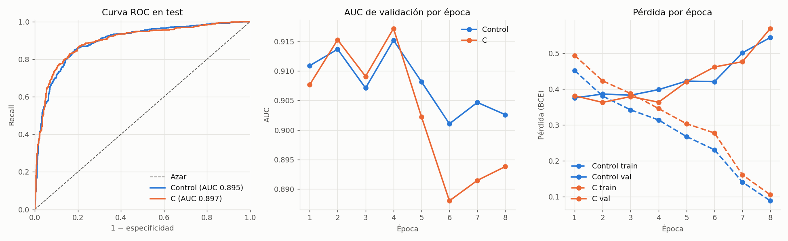
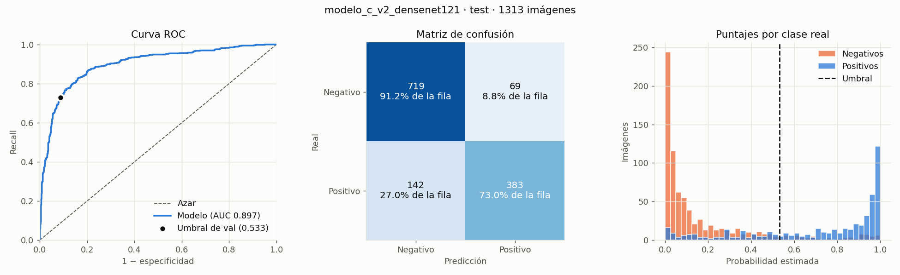

# Modelo C: negativas elegidas como en el test oficial · Effusion

**Antes:** [`RESULTADOS_MODELOS.md`](RESULTADOS_MODELOS.md) · **Red:** DenseNet121 preentrenada en ImageNet, una salida · **Seed:** 42

## Por qué
El modelo B sacó F1 0,744 en el test oficial, contra 0,800 en validación. El análisis de sus errores mostró:
- **El problema son los falsos positivos.** Recall 93% y especificidad 62%. Con la especificidad de validación (81%), el F1 en test habría sido 0,84.
- **El umbral no lo arregla.** Aun eligiendo el umbral mirando test, que no vale, el mejor F1 posible era 0,769.
- **Los falsos positivos se concentran en negativas difíciles.** De los 1.005, 425 son de pacientes con 10 o más estudios previos y 489 tienen otros hallazgos.
- **El test oficial es otra población.** En la submuestra evaluada con B, el 53% de las positivas y el 25% de las negativas son de pacientes con 10 o más estudios previos (en las negativas PA del test oficial completo, el 38%). En `train_val` son el 22% y el 9%.

**Hipótesis:** si las negativas de train tienen la misma mezcla de estudios previos que el test oficial, el modelo aprende a no confundir "paciente con muchos estudios" con derrame, y baja los falsos positivos.

## Por qué hace falta un test nuevo
El test oficial ya se usó para evaluar B y para analizar sus errores. Evaluar ahí un modelo diseñado a partir de esos errores daría un resultado optimista. Por eso:
- Las imágenes del test oficial quedan **afuera** de este experimento.
- Train, validación y un **test nuevo** salen de los pacientes de `train_val_list.txt`, divididos por paciente.
- Val y test nuevo se arman con la **misma mezcla de estudios previos que la submuestra del test oficial evaluada con B**, para medir sobre una población parecida.

## Datos
Configs: [`nih_v2_control.json`](../configs/nih_v2_control.json) y [`nih_v2_c.json`](../configs/nih_v2_c.json). Comando: `PYTHONPATH=src .venv/bin/python -m rx_torax.prepare --config <config>`.

Mezcla del test oficial, medida en los 4.390 casos que se evaluaron con B:

| Estudios previos | Positivas | Negativas sin hallazgos | Negativas con otros hallazgos |
|---|---|---|---|
| 0 | 5,0% | 27,6% | 6,7% |
| 1 a 9 | 41,9% | 21,7% | 19,1% |
| 10 o más | 53,1% | 15,7% | 9,2% |

1. **Split por paciente:** 60% train, 15% val y 25% test de los pacientes de `train_val`, con seed 42. Es el mismo para los dos modelos.
2. **Val y test nuevo:** se elige la mayor cantidad de positivas que respete la mezcla, y negativas hasta llegar a 40% de positivas, también con la mezcla. Son idénticos byte a byte para los dos modelos.
3. **Train:** se usan todas las positivas. Las negativas se eligen hasta llegar a 40% de positivas, con un máximo de 3 por paciente:
   - **Control:** al azar, 65% sin hallazgos y 35% con otros hallazgos, como en el modelo A.
   - **Modelo C:** con la mezcla del test oficial.

Es el **único cambio** entre los dos. Los hiperparámetros son los del modelo A, sin repetir positivas: [`modelo_control_v2.json`](../configs/modelo_control_v2.json) y [`modelo_c_v2.json`](../configs/modelo_c_v2.json).

| Conjunto | Imágenes | Pacientes | Positivas | Negativas con 10+ estudios previos |
|---|---|---|---|---|
| Train del control | 7.252 | 4.749 | 2.901 | 361 (8,3%) |
| Train de C | 7.252 | 4.350 | 2.901 | 1.080 (24,8%) |
| Val, igual en los dos | 732 | 498 | 293 | 109 (24,8%) |
| Test nuevo, igual en los dos | 1.313 | 865 | 525 | 196 (24,9%) |

**Verificaciones:** ninguna imagen del test oficial, ningún paciente compartido entre conjuntos, y val y test idénticos byte a byte entre las dos preparaciones. En val y en el test nuevo, el 53% de las positivas son de pacientes con 10 o más estudios previos, como en el test oficial.

## Decisión, tomada antes de abrir el test nuevo
- Cada modelo elige su época y su umbral en validación. El test nuevo se evalúa **una vez por modelo**, con `rx-evaluar`.
- Se informan el F1 de cada uno con IC 95% por paciente y la diferencia pareada C − control en test, con `rx-comparar --conjunto test`.
- **Criterio de éxito:** F1 del modelo C en el test nuevo ≥ 0,80, el valor que da de ejemplo la consigna. C mejora al control si el intervalo de la diferencia de F1 queda entero por encima de 0.
- Salga lo que salga, se informa y no se cambia nada a partir del test nuevo, que tampoco se vuelve a usar.

## Limitaciones conocidas de antemano
- **Train es más chico** que el de A y B: 2.901 positivas contra 4.108. Por eso el control existe: compara contra la misma cantidad de datos.
- **Se descartan positivas.** Las de pacientes de val y test que no entran en la mezcla no pueden pasar a train, porque serían los mismos pacientes.
- **El test nuevo es más chico** que el oficial, así que los intervalos son más anchos.
- **No es el test oficial.** Imita su mezcla de estudios previos, pero sus pacientes vienen de `train_val`. El F1 que salga no se compara directamente con el 0,744 de B.

## Entrenamiento y validación
Los dos modelos eligieron la época 4. En C, desde la época 5 la pérdida de validación sube mientras la de train sigue bajando; en el control ya subía, con oscilaciones, desde la época 1. Es sobreajuste, y el early stopping lo cortó a tiempo.

| Validación (732 imágenes) | Control | Modelo C | C − control (IC 95%) |
|---|---|---|---|
| F1 | 0,809 | 0,827 | +0,018 (−0,008 a +0,046) |
| AUC | 0,915 | 0,917 | +0,002 (−0,012 a +0,015) |
| Especificidad | 85,2% | 89,5% | +4,3 puntos (+1,6 a +7,2) |
| Umbral elegido | 0,636 | 0,533 | |

## Resultados en el test nuevo
Cada modelo se evaluó una sola vez, con el umbral de validación. Son 1.313 radiografías de 865 pacientes, 525 positivas.

| Test nuevo | Control | Modelo C | C − control (IC 95%) |
|---|---|---|---|
| **F1 (IC 95%)** | 0,775 (0,729 a 0,814) | **0,784 (0,736 a 0,823)** | +0,009 (−0,015 a +0,033) |
| AUC | 0,895 | 0,897 | +0,002 (−0,010 a +0,013) |
| Recall | 74,7% | 73,0% | −1,7 puntos (−5,3 a +1,6) |
| Especificidad | 87,9% | 91,2% | **+3,3 puntos (+1,4 a +5,3)** |
| Precisión | 80,5% | 84,7% | **+4,2 puntos (+1,6 a +7,1)** |
| Falsos positivos | 95 | 69 | −26 |
| Falsos negativos | 133 | 142 | +9 |

La referencia trivial, siempre positivo, da F1 0,571.





### Contra la decisión tomada antes
- **F1 ≥ 0,80: no se cumple.** C saca 0,784. El intervalo llega a 0,823, así que tampoco se puede descartar que el valor real sea 0,80 o más.
- **C mejor que el control: no se detectó.** El intervalo de la diferencia de F1 incluye el 0, así que no se rechaza H0 (diferencia nula) con α = 0,05. Eso no prueba que sean iguales (slides 04, p. 19).
- **Lo que sí se confirmó:** la hipótesis predecía menos falsos positivos, y pasó. La especificidad y la precisión suben con intervalos enteros por encima de 0. Pero el recall baja un poco y el F1 casi no se mueve.

### Por estudios previos
Análisis descriptivo, hecho después de evaluar. No cambia ningún modelo.

| Estudios previos | Positivas | Recall control / C | Especificidad control / C | AUC control / C |
|---|---|---|---|---|
| 0 | 26 | 57,7% / 61,5% | 95,6% / 96,3% | 0,861 / 0,836 |
| 1 a 9 | 220 | 70,5% / 69,5% | 84,2% / 88,5% | 0,866 / 0,875 |
| 10 o más | 279 | 79,6% / 76,7% | 83,7% / 88,8% | 0,878 / 0,886 |

- C gana especificidad sobre todo en pacientes con estudios previos, que es donde cambió sus negativas de train. Son valores puntuales, sin intervalos por subgrupo: el grupo de 0 estudios previos tiene solo 26 positivas y no es concluyente.
- **El test nuevo no reproduce el problema del test oficial.** En pacientes con 10 o más estudios previos, hasta el control tiene especificidad 83,7% y AUC 0,878. El modelo B, en el test oficial, tenía 35,0% y 0,779. Son modelos distintos, pero sugiere que la mezcla de estudios previos no explica sola la caída del test oficial: esos pacientes difieren en algo que los metadatos no muestran.

### Por qué no llega a 0,80
- **Ahora el error son los falsos negativos.** El recall baja de 81,6% en validación a 73,0% en test. El umbral se eligió maximizando F1 en validación, y ahí queda optimista.
- **El umbral tampoco alcanzaría.** Eligiéndolo mirando test, que no vale, el mejor F1 posible sería 0,800 para C y 0,799 para el control. La separación entre clases (AUC 0,90) es el límite: para pasar 0,80 con margen hace falta un modelo que separe mejor, no otro umbral.

## Conclusiones
1. **C es el mejor de los dos en el test nuevo** (F1 0,784), pero no es significativamente mejor que el control en F1, y no llega a 0,80.
2. **Elegir las negativas con la mezcla del test baja los falsos positivos** de forma significativa: −26 en test, con especificidad +3,3 puntos.
3. **La mezcla de estudios previos no alcanza para explicar la caída del test oficial.** Un test con la misma mezcla, pero con pacientes de `train_val`, no muestra el problema.
4. **El test nuevo ya se usó.** Cualquier modelo nuevo necesitaría otro conjunto de prueba independiente.

## Reproducir
```bash
PYTHONPATH=src .venv/bin/python -m rx_torax.prepare --config configs/nih_v2_control.json
PYTHONPATH=src .venv/bin/python -m rx_torax.prepare --config configs/nih_v2_c.json
PYTHONPATH=src .venv/bin/python -m rx_torax.training.train --config configs/modelo_control_v2.json
PYTHONPATH=src .venv/bin/python -m rx_torax.training.train --config configs/modelo_c_v2.json
PYTHONPATH=src .venv/bin/python -m rx_torax.evaluation.compare --modelos models/modelo_control_v2_densenet121 models/modelo_c_v2_densenet121 --nombres Control C --salida models/comparacion_val_control_c
```

La evaluación en test se corre una sola vez por modelo; `rx-evaluar` se niega a repetirla:

```bash
PYTHONPATH=src .venv/bin/python -m rx_torax.evaluation.evaluate --modelo models/modelo_control_v2_densenet121 --conjunto test
PYTHONPATH=src .venv/bin/python -m rx_torax.evaluation.evaluate --modelo models/modelo_c_v2_densenet121 --conjunto test
PYTHONPATH=src .venv/bin/python -m rx_torax.evaluation.compare --modelos models/modelo_control_v2_densenet121 models/modelo_c_v2_densenet121 --nombres Control C --salida models/comparacion_test_control_c --conjunto test
```
