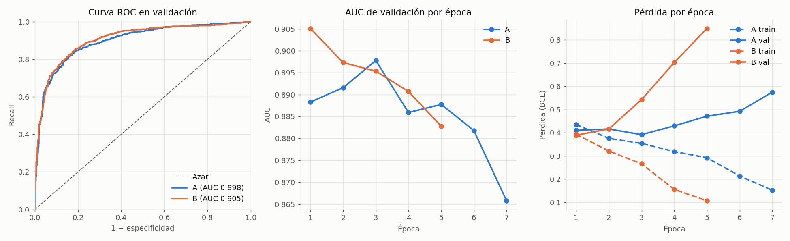
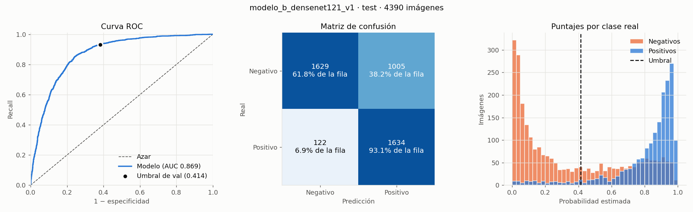
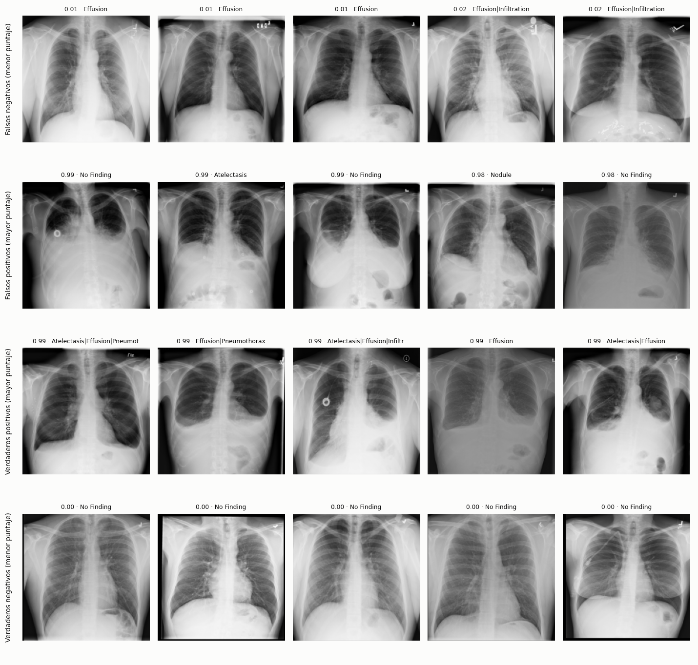

# Resultados: modelo A vs modelo B · Effusion

**Datos:** [`SPLITS_NIH_EFFUSION.md`](SPLITS_NIH_EFFUSION.md) · **Red:** DenseNet121 preentrenada en ImageNet, una salida · **Seed:** 42

## Los dos modelos
El profesor pidió comparar dos formas de llegar a 40% de positivos en train:

| | Modelo A: sacar negativas | Modelo B: repetir positivas |
|---|---|---|
| Config de datos | [`nih.json`](../configs/nih.json) | [`nih_modelo_b.json`](../configs/nih_modelo_b.json) |
| Config de entrenamiento | [`modelo_a.json`](../configs/modelo_a.json) | [`modelo_b.json`](../configs/modelo_b.json) |
| Imágenes distintas en train | 10.270 (4.108 positivas, 6.162 negativas) | 22.594 (4.108 positivas, 18.486 negativas) |
| Muestras por época | 10.270 | 30.810 (cada positiva 3 veces) |
| Val y test | los mismos 1.813 y 4.390 | idénticos byte a byte a los de A |

Todo lo demás es igual: hiperparámetros, augmentation (rotación ±7°, escala y desplazamiento ±5%, sin espejar), early stopping por AUC de validación con paciencia 4 y umbral elegido en validación maximizando F1.

**Ojo con la comparación:** B no solo repite positivas, también ve 3 veces más negativas distintas. Si B sale mejor, no se puede atribuir solo a la repetición.

## Protocolo
1. **Train** ajusta los pesos. **Validación** elige la época, el umbral y el modelo final.
2. **Test** se usa una sola vez, con el modelo y el umbral ya fijados. `rx-evaluar` se niega a evaluar dos veces el mismo conjunto.
3. Los intervalos de confianza son bootstrap de 2.000 remuestreos **por paciente**, porque las imágenes de un mismo paciente no son independientes. En la comparación, el bootstrap es pareado: A y B se miden sobre las mismas muestras.

```bash
PYTHONPATH=src .venv/bin/python -m rx_torax.evaluation.compare --modelos models/modelo_a_densenet121_v1 models/modelo_b_densenet121_v1 --nombres A B --salida models/comparacion_val_a_b
PYTHONPATH=src .venv/bin/python -m rx_torax.evaluation.evaluate --modelo models/modelo_b_densenet121_v1 --conjunto test
```

## Comparación en validación
1.813 imágenes de 1.181 pacientes, 40% positivas.



| | A | B | B − A (IC 95%) |
|---|---|---|---|
| AUC | 0,898 | 0,905 | +0,007 (−0,002 a +0,016) |
| F1 | 0,795 | 0,800 | +0,005 (−0,010 a +0,021) |
| Recall | 81,4% | 85,5% | **+4,1 pts (+2,2 a +6,2)** |
| Especificidad | 84,5% | 81,2% | **−3,3 pts (−5,2 a −1,6)** |
| Precisión | 77,7% | 75,2% | −2,6 pts (−4,6 a −0,7) |
| Umbral | 0,379 | 0,414 | |
| Mejor época | 3 de 7 | 1 de 5 | |
| Tiempo de entrenamiento | 48 min | 79 min | |

- **Sin diferencia significativa en AUC ni en F1.** Planteado como test de hipótesis (slides 04, pp. 11-12): H0 dice que la diferencia es 0, con α = 0,05 fijado antes. Los IC 95% de la diferencia incluyen el 0, así que no se rechaza H0; eso no prueba que A y B sean iguales (slides 04, p. 19). Los modelos discrepan en 154 de 1.813 imágenes: A acierta 80 que B falla y B acierta 74 que A falla.
- **Cambia el punto de operación:** B detecta más derrames y da más falsas alarmas. Esa diferencia sí es significativa.
- **Los dos sobreajustan rápido.** El mejor punto llega después de ~30.800 muestras en ambos (3 épocas de A, 1 de B). Desde ahí la pérdida de train baja y la de validación sube; en B sube más rápido porque ve cada positiva 3 veces por época.
- **Subgrupos (validación):** en los dos modelos el rendimiento baja contra negativas con otros hallazgos (AUC 0,865 A / 0,877 B) frente a negativas sin hallazgos (0,915 / 0,920), y en pacientes con 10 o más estudios previos (AUC 0,83 / 0,84, especificidad 66% / 60%).

## Decisión, tomada antes de abrir test
- **Modelo final: B**, con su umbral de validación **0,414**. Es el de mayor AUC en validación, el mismo criterio que usó el entrenamiento para elegir la época. La ventaja sobre A no es significativa.
- Test se evalúa una vez, solo con B. A no se evalúa en test, para que el resultado no influya en la elección.
- De test se informan AUC, matriz de confusión, recall, especificidad, precisión y F1 con IC 95% por paciente; la referencia trivial; la precisión esperada con prevalencias reales; los subgrupos; y ejemplos de aciertos y errores.
- Si test sale peor que validación, se informa igual. No se cambia de modelo ni de umbral a partir de test.

## Test: modelo B, evaluación única
Submuestra del test oficial: 4.390 imágenes de 1.686 pacientes, 1.756 positivas (40%). Tiene todas las positivas PA de `test_list.txt` y negativas elegidas como en train (65% sin hallazgos, máximo 3 por paciente). Umbral 0,414, fijado en validación.



| | Test (IC 95%) | Validación | Siempre positivo |
|---|---|---|---|
| AUC | **0,869** (0,858 a 0,880) | 0,905 | 0,5 |
| F1 | **0,744** (0,726 a 0,761) | 0,800 | 0,571 |
| Recall | 93,1% (91,6 a 94,4) | 85,5% | 100% |
| Especificidad | 61,8% (59,5 a 64,3) | 81,2% | 0% |
| Precisión | 61,9% (59,7 a 64,2) | 75,2% | 40,0% |
| Exactitud | 74,3% | 82,9% | 40,0% (siempre negativo: 60,0%) |

- **Matriz de confusión:** 1.634 verdaderos positivos, 122 falsos negativos, 1.005 falsos positivos y 1.629 verdaderos negativos.
- **Con umbral 0,5** (solo como referencia, no se usa): F1 0,755, recall 91,2%, especificidad 66,3%.
- **Con la prevalencia real** y el mismo recall y especificidad, la precisión sería 20,9% con 9,8% de positivos (F1 0,34) y 31,4% con 15,8% (F1 0,47). Es decir, como mucho sirve para priorizar estudios, no para diagnosticar. El umbral 0,414 es el óptimo para 40% de positivos; reponderando validación a 9,8%, el óptimo sería ~0,77.
- **Con la mezcla natural de negativas.** En la submuestra, las negativas son 65% sin hallazgos y con máximo 3 por paciente; en el test oficial son 51,4% y sin tope, con más pacientes de muchos estudios previos. El 65% se tomó de todas las negativas PA, test incluido; en clase, lo que se calcula sale de train y en test solo se aplica (slides 06, pp. 30-31). Reponderando la especificidad de B por grupo (análisis posterior, sin cambiar modelo ni umbral):

| Mezcla de negativas | Especificidad | F1 con 40% | F1 con 15,8% |
|---|---|---|---|
| Submuestra evaluada | 61,8% | 0,744 | 0,470 |
| Natural, por tipo de negativa | 58,7% | 0,730 | 0,451 |
| Natural, por tipo y estudios previos | 54,2% | 0,711 | 0,426 |
- **Tiempo:** ~12 ms por imagen en lote con MPS (Mac M4). En CPU, de a una imagen, entre 80 y 600 ms: la medición se hizo con la máquina cargada por otros procesos.

### Por qué test sale peor que validación
El modelo detecta más (recall 93%) pero confunde muchas más negativas: la especificidad baja de 81% a 62%. La mayor parte del problema está en los pacientes con muchos estudios previos (`Follow-up #` de NIH), que en el test oficial son muchos más:

| Estudios previos | Negativas en val | Negativas en test | Especificidad val | Especificidad test | AUC val | AUC test |
|---|---|---|---|---|---|---|
| 0 | 46,8% | 34,3% | 88,6% | 87,9% | 0,909 | 0,957 |
| 1 a 9 | 44,2% | 40,9% | 77,5% | 56,2% | 0,899 | 0,845 |
| 10 o más | 9,0% | 24,8% | 60,2% | 35,0% | 0,842 | 0,779 |

- **La mezcla explica una parte.** Si las negativas de test tuvieran la misma mezcla que las de validación, la especificidad sería 69,2% en vez de 61,8%. El resto es una caída dentro de los grupos con estudios previos.
- **Validación no se parecía a test.** Validación es un 15% al azar de los pacientes de `train_val_list.txt`, así que se parece a train. El test oficial de NIH tiene más pacientes seguidos durante mucho tiempo, probablemente internados.
- **Posible atajo.** El número de estudios previos, sin mirar la imagen, ya separa positivas de negativas con AUC 0,67 en validación y 0,73 en test. El modelo podría estar aprendiendo signos de "paciente internado" (dispositivos, posición, otras patologías) además del derrame. Esto no mide los dispositivos directamente: para eso hay que anotar una muestra a mano.
- **El atajo, medido en el modelo.** Correlación de Spearman entre el puntaje de B y los estudios previos dentro de cada clase (slides 03, p. 50; IC 95% por bootstrap de 2.000 remuestreos de pacientes). Es un análisis posterior: no cambia el modelo ni el umbral.

| Clase | Validación | Test |
|---|---|---|
| Negativas | 0,26 (0,19 a 0,32) | 0,49 (0,45 a 0,52) |
| Positivas | 0,03 (−0,05 a 0,12) | −0,03 (−0,08 a 0,03) |

  Entre las negativas, a más estudios previos, más puntaje; entre las positivas no hay relación. Es lo esperable si el modelo aprende en parte "paciente internado".
- **Otros hallazgos confunden.** La especificidad es 69,9% con negativas sin hallazgos y 47,0% con negativas que tienen otros hallazgos.
- **Sexo y edad:** AUC 0,855 en mujeres y 0,880 en hombres; entre grupos de edad, de 0,859 a 0,881.

### Aciertos y errores
Los cinco casos más seguros de cada celda de la matriz:



- Varios **falsos positivos** con puntaje 0,98–0,99 están etiquetados como *No Finding*, *Nodule* o *Atelectasis*, pero muestran opacidades evidentes en las bases o un puerto implantado. Coincide con el ruido de etiquetas de NIH, que salen de procesar los informes con NLP; confirmarlo requiere un radiólogo.
- Los **falsos negativos** con puntaje ~0,01 no muestran cambios evidentes a 224×224. Pueden ser derrames chicos que se pierden con la reducción, o errores de etiqueta.
- Lo mismo se vio en validación: no es algo propio de test.

## F1-Score: la métrica de éxito de la consigna
La consigna pide medir el éxito con una métrica objetiva y compararla con una referencia sin IA, y da como ejemplo "alcanzar un F1-Score > 0,80". El F1 combina precisión y recall:

**F1 = 2 · precisión · recall / (precisión + recall)**

No cuenta los verdaderos negativos. Por eso, con 60% de negativas, no se infla como la exactitud.

| | Modelo A, validación | Modelo B, validación | Modelo B, test |
|---|---|---|---|
| **F1 (IC 95%)** | 0,795 (0,769 a 0,821) | 0,800 (0,773 a 0,825) | **0,744 (0,726 a 0,761)** |
| Precisión | 77,7% | 75,2% | 61,9% |
| Recall | 81,4% | 85,5% | 93,1% |
| Umbral | 0,379 | 0,414 | 0,414, el de validación |
| Siempre positivo | 0,571 | 0,571 | 0,571 |

- **Contra la referencia trivial:** el modelo la supera siempre. En test la diferencia es +0,17, y el intervalo queda entero por encima.
- **Contra el 0,80 que la consigna da como ejemplo:** validación queda justo en el límite (0,800, con un intervalo que incluye valores por debajo). Además es optimista, porque ahí se eligieron la época y el umbral. **Test no lo alcanza:** el intervalo entero queda por debajo de 0,80. El 0,80 no se fijó como objetivo antes de evaluar: se informa como la referencia de la consigna.
- **A contra B:** la diferencia de F1 en validación es +0,005 (−0,010 a +0,021). Incluye el 0: no se detectó una diferencia significativa.
- **Con umbral 0,5,** test daría 0,755. No se usa: elegir el umbral mirando test invalidaría la evaluación.
- **Depende de la proporción de positivos.** Con el mismo recall y la misma especificidad de test, el F1 sería 0,34 con 9,8% de positivos (todo NIH PA) y 0,47 con 15,8% (test oficial completo). El 0,744 vale para conjuntos con 40% de positivos.

## Probar el modelo con otra imagen
`rx-predecir` le aplica a cada PNG, JPEG o TIFF la misma transformación que la preparación, y después el umbral 0,414 guardado en `modelo.pt`:

```bash
PYTHONPATH=src .venv/bin/python -m rx_torax.inference.predict --modelo models/modelo_b_densenet121_v1 data/raw/nih/images/00010080_003.png
```

- Imprime el puntaje y la decisión de cada imagen. Con `--salida archivo.csv`, además los guarda.
- Sobre imágenes de validación da los mismos puntajes que `rx-evaluar`.
- Solo tiene sentido con radiografías PA de tórax. Con la prevalencia real, unas 4 de cada 5 alarmas serían falsas: ver la precisión con prevalencia real, más arriba.

## Conclusiones
1. **El modelo aprende algo real:** AUC 0,87 en pacientes que nunca vio, y F1 0,74 contra 0,57 de la referencia trivial.
2. **Validación sobreestimó el rendimiento.** Parte de la caída se explica porque test tiene otra población de pacientes (con la mezcla de validación, la especificidad sería 69% en vez de 62%), no por haber elegido mal entre A y B.
3. **A vs B:** en validación no hay diferencia significativa en AUC ni en F1. B cambia el punto de operación hacia más recall y menos especificidad, y tarda más en entrenar.
4. **El umbral elegido en validación queda bajo para test:** genera muchos falsos positivos. No se ajustó, porque eso sería usar test para decidir.

## Siguiente experimento: modelo C
Para intentar llegar a 0,80 se entrenó un modelo C con las negativas de train elegidas con la mezcla de estudios previos del test oficial. Se lo comparó con un control, sobre un test nuevo armado con pacientes de `train_val`. C saca F1 0,784 (0,736 a 0,823): baja los falsos positivos, pero no mejora el F1 de forma significativa y no llega a 0,80. El detalle está en [el modelo C](MODELO_C.md).

## Pendiente
- Medir el efecto de los dispositivos anotando a mano una muestra de test.
