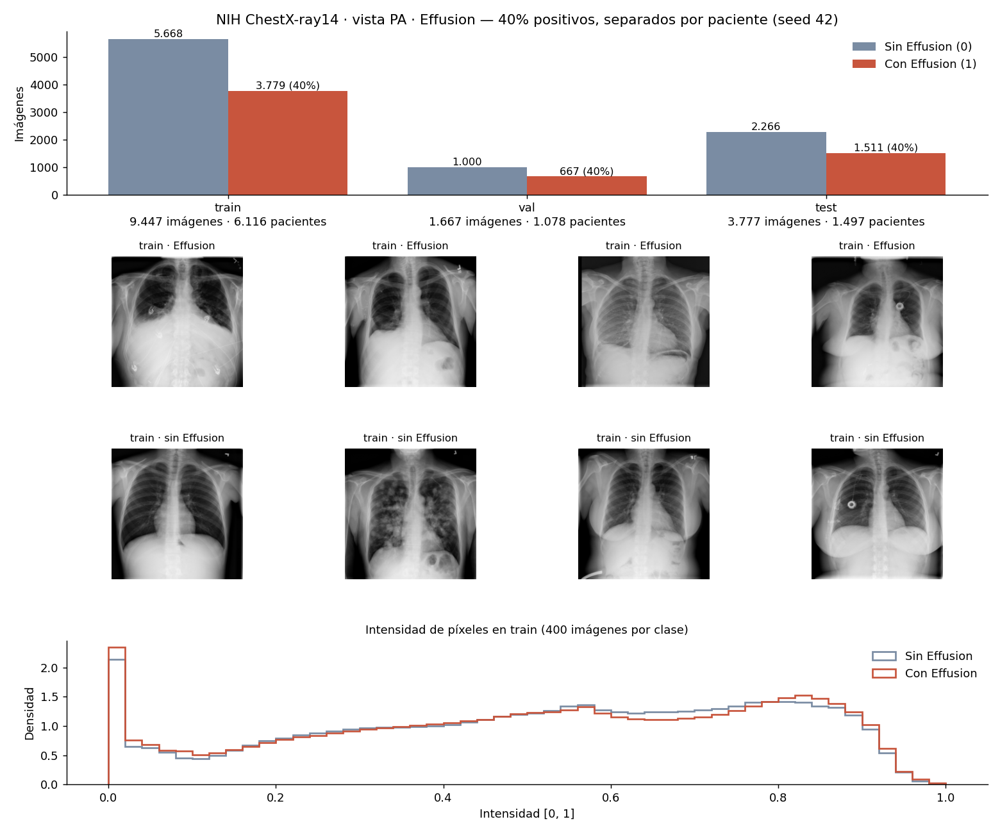

# Train, validación y test: NIH ChestX-ray14 · Effusion

**Config:** [`configs/nih.json`](../configs/nih.json) · **Seed:** 42 · **Salida:** `data/processed/nih_effusion_pa_40_60_v1/` (3,1 GB, fuera de git)

**Comando:** `PYTHONPATH=src .venv/bin/python -m rx_torax.prepare --config configs/nih.json`

Reemplaza a la versión de Pneumothorax ([`SPLITS_NIH_PNEUMOTHORAX.md`](SPLITS_NIH_PNEUMOTHORAX.md)), que tenía 3,6% de positivos en train y 13,9% en test.

## Problema
Clasificación binaria sobre radiografías **PA**:
- **1:** la imagen tiene la etiqueta *Effusion*, sola o con otros hallazgos.
- **0:** radiografía PA sin esa etiqueta. Un 0 no significa radiografía normal.

## Conjuntos

| Conjunto | Total | Con Effusion | Sin hallazgos | Otros hallazgos | Pacientes |
|---|---|---|---|---|---|
| **Train** | 10.270 | 4.108 (40%) | 4.005 (39%) | 2.157 (21%) | 6.707 |
| **Val** | 1.813 | 725 (40%) | 707 (39%) | 381 (21%) | 1.181 |
| **Test** | 4.390 | 1.756 (40%) | 1.712 (39%) | 922 (21%) | 1.686 |
| **Total** | **16.473** | **6.589** | **6.424** | **3.460** | **9.574** |

## Datos usados
De las 112.120 filas del CSV, con los 12 archivos de imágenes completos:

| Motivo | Filas |
|---|---|
| Vista AP, excluida | 44.810 |
| Imágenes duplicadas, excluidas | 12 |
| **Aceptadas (PA)** | **67.298** |

De las aceptadas se usan todas las positivas (6.589) y una muestra de negativas (9.884). Las demás no se borran: simplemente no entran en los arrays.

**Ubicación de las imágenes:** el pipeline las busca dentro de `data/raw/nih/`. Hoy `data/raw/nih/images/` tiene enlaces simbólicos a las carpetas descargadas. La carpeta `images 10` no se usa porque es una copia de `images 12`; `images_010` se descargó de nuevo en `images 10 ok`.

## Flujo aplicado
1. **Selección de vista:** solo PA.
2. **Auditoría:** se abre cada imagen, se detectan ilegibles y duplicados por hash de píxeles.
3. **Split por paciente:** test es el oficial de NIH. Val es el 15% de los pacientes de `train_val_list.txt`.
4. **Selección 60/40 en cada conjunto:** todas las positivas y negativas al azar con seed fija. Las negativas son 65% sin hallazgos y 35% con otros hallazgos, con hasta 3 por paciente. El 65% sale de todas las negativas PA, test incluido (64,7%; solo con `train_val` da 67,1%).
5. **Transformación:** escala de grises, 224×224 sin deformar (bordes negros) e intensidades en [0, 1].
6. **Estadísticas solo con train:** media 0,508 y desvío 0,265, guardadas en `preprocessing.json` para aplicarlas sin recalcular a val, test e imágenes nuevas.

No se repiten imágenes ni se aplica augmentation en esta etapa.

## Verificaciones
Se validaron contra el CSV original, por fuera del código de preparación. Se reproducen, junto con el resto del análisis exploratorio, en [`notebooks/00_eda_nih_effusion.ipynb`](../notebooks/00_eda_nih_effusion.ipynb):
- 0 pacientes compartidos y 0 imágenes idénticas entre conjuntos.
- Todas las imágenes son PA, y cada `y` coincide con su etiqueta original.
- Test contiene solo imágenes de `test_list.txt`; train y val, solo de `train_val_list.txt`.
- Están las 6.589 Effusion PA disponibles.
- 40,0% de positivos y 65,0% de negativas sin hallazgos en los tres conjuntos.
- Máximo de 3 negativas por paciente en cada conjunto.
- Edad media con/sin Effusion: 51,3/46,5 años en train y 49,9/47,2 en test. Hombres con/sin Effusion: 55%/54% en train y 55%/56% en test.

## Diferencia con el material de clase
La notebook de desbalance de la cátedra (`06_feature_engineering_avanzado/03_desbalance.ipynb`, celdas 14 y 15) y el flujo de preparación (slides 06, pp. 29, 31 y 35) balancean **solo train**. Acá también se ajustan val y test porque el profesor pidió el mismo porcentaje en train y test. En val y test solo se eligen imágenes: no se repite ninguna ni se generan sintéticas.

**Consecuencia:** la proporción real en PA es ~10% en todo NIH y 15,8% en el test oficial. Con 40%, la precisión y el F1 salen más altos que con esas proporciones. Recall, especificidad y AUC dependen mucho menos de la proporción.

Además, la mezcla 65/35 y el tope de 3 negativas por paciente también se aplicaron en val y test. En clase, lo que se calcula sale de train y en test solo se aplica (slides 06, pp. 30-31). Por eso el test es una **submuestra** del oficial, más fácil que el completo: sus negativas tienen menos pacientes con muchos estudios previos. El efecto sobre la especificidad está en [`RESULTADOS_MODELOS.md`](RESULTADOS_MODELOS.md).

## Limitaciones
- **Dispositivos:** en una muestra chica de 96 fotos de la selección anterior, sin `images_010` y revisada a ojo, se ven cables, catéteres, puertos o implantes en ~30% de las positivas y ~13% de las negativas. NIH no los marca, así que siguen incluidos. El modelo podría aprender esa señal: hay que medirlo en la evaluación.
- **Calidad de imagen:** en una muestra de 4.000 fotos PA, tomada antes de sumar `images_010`, los marcos blancos rondan el 0,3% y el contraste bajo el 1,3%. Se ven legibles, así que no se aplicó ningún filtro.
- **Controles previos:** los pacientes con Effusion tienen más estudios previos, lo que puede agregar señales ajenas al hallazgo.
- **Etiquetas:** NIH las extrajo automáticamente de informes médicos, así que contienen errores. Al revisar los outliers de train apareció una placa lateral etiquetada como PA (`00008347_002.png`, negativa); no se sacó para no rehacer los conjuntos.
- **Outliers:** con IQR y ±3σ sobre el brillo y el contraste de train se marcan placas lavadas o con bordes, en proporción parecida en las dos clases; se conservan ([notebook 00](../notebooks/00_eda_nih_effusion.ipynb), sección 8). Reemplaza la revisión anterior de una muestra de 4.000.
- **Test oficial:** sus pacientes tienen más estudios por persona que los de train.

## Modelos
- **Modelo A (sacar negativas):** se entrena con estos arrays.
- **Modelo B (repetir positivas):** usa [`configs/nih_modelo_b.json`](../configs/nih_modelo_b.json), que agrega negativas solo en train (22.594 imágenes). Val y test quedan idénticos a los de esta versión.

Resultados y comparación en [`RESULTADOS_MODELOS.md`](RESULTADOS_MODELOS.md).
