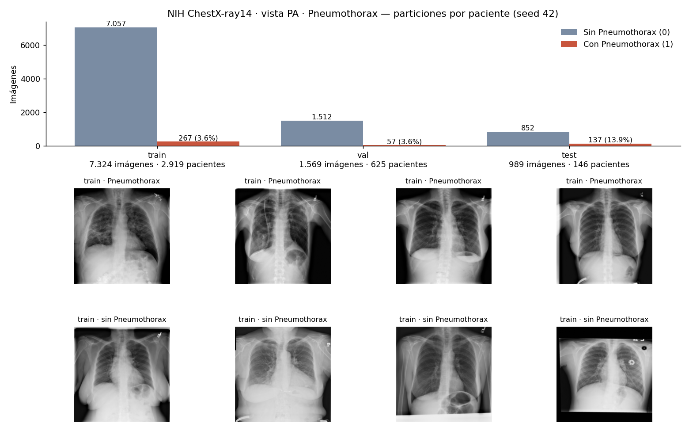

# Train, validación y test: NIH ChestX-ray14 · Pneumothorax

**Generado:** 25/10/2026 · **Config:** [`configs/nih.json`](../configs/nih.json) · **Seed:** 42
**Comando:** `.venv/bin/python -m rx_torax.prepare --config configs/nih.json`

## Problema
Clasificación binaria sobre radiografías de tórax en vista **PA**:
- **1:** la imagen tiene la etiqueta *Pneumothorax*.
- **0:** cualquier otra radiografía PA, incluidas las que tienen otros hallazgos.

Un 0 no significa radiografía normal: significa que ese hallazgo no está anotado.

## Datos usados
- **Fuente:** NIH ChestX-ray14 (`Data_Entry_2017_v2020.csv`, 112.120 filas).
- Descargamos `images_001` e `images_002`: 14.999 imágenes de 1024×1024.
- Nos quedamos con las **9.882 en vista PA**. Ninguna resultó ilegible ni duplicada.
- **Exclusiones registradas** en `exclusiones.csv`:
  - 97.121 filas cuyas imágenes no descargamos.
  - 5.117 imágenes con vista AP.

## Particiones

| Conjunto | Imágenes | Pacientes | Sin Pneumothorax | Con Pneumothorax | % positivos |
|---|---|---|---|---|---|
| train | 7.324 | 2.919 | 7.057 | 267 | 3,6% |
| val | 1.569 | 625 | 1.512 | 57 | 3,6% |
| test | 989 | 146 | 852 | 137 | 13,9% |

- **Test:** es el **test oficial de NIH** (`test_list.txt`), restringido a las imágenes que descargamos.
- **Validación:** se separa del `train_val_list.txt` oficial, **por paciente**, buscando con seed fija la partición que más se acerque a las proporciones 70/15 sin dejar de lado ninguna clase.
- **Chequeos automáticos aprobados:**
  - Ningún paciente aparece en más de un conjunto.
  - Ninguna imagen idéntica (por hash de píxeles) aparece en dos conjuntos.
  - Las dos clases están presentes en cada conjunto.

## Preprocesamiento
Sigue el flujo "split → calcular en train → aplicar a todos" visto en clase.

1. **Split primero**, antes de calcular cualquier transformación.
2. Cada imagen se pasa a **escala de grises** y se lleva a **224×224** sin deformarla: se redimensiona respetando la proporción y se completan los bordes en negro. Las intensidades se escalan a [0, 1] dividiendo por 255.
3. **Estadísticas de normalización calculadas solo con train**: media 0,544 y desvío 0,258. Quedan guardadas en `preprocessing.json` para aplicarlas igual a val, a test y a imágenes nuevas.
4. **Balanceo pendiente:** se va a aplicar **solo en train** al entrenar, con pesos de clase o sobremuestreo. Val y test conservan su distribución real.

## Salida
Queda en `data/processed/nih_pneumothorax_pa_v1/`, excluida de git (1,8 GB):

| Archivo | Contenido |
|---|---|
| `X_train.npy`, `X_val.npy`, `X_test.npy` | Imágenes `float32` con forma (N, 224, 224) |
| `y_train.npy`, `y_val.npy`, `y_test.npy` | Etiquetas 0/1 |
| `train.csv`, `val.csv`, `test.csv` | Trazabilidad: imagen, paciente, etiqueta original y `array_index` |
| `report.json`, `preprocessing.json`, `config.json`, `exclusiones.csv` | Reporte, parámetros y exclusiones para reproducir y auditar |

## Limitaciones a considerar
- **Desbalance:** en train hay un 3,6% de positivos, así que accuracy no sirve como métrica. Vamos a medir F1, recall y AUC contra un baseline que predice siempre "sin Pneumothorax".
- **Test con distinta proporción:** el test oficial tiene más positivos (13,9%) que train y val. Hay que tenerlo en cuenta al interpretar las métricas.
- **Posible atajo del modelo:** en NIH, muchas radiografías con neumotórax ya muestran el tubo de drenaje. El modelo podría aprender a reconocer el tubo en lugar del neumotórax. Lo vamos a revisar en el análisis de errores.
- **Etiquetas:** las de NIH se extrajeron automáticamente de los informes médicos, así que contienen errores.
